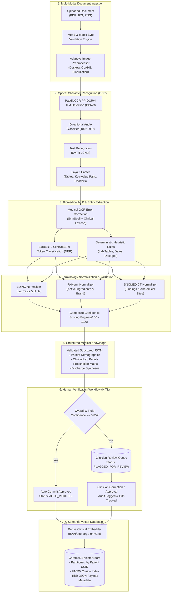

# MediVault AI — Production Healthcare Document Intelligence System

> **Architecture & Engineering Specification · Production Grade**  
> **Role:** Senior AI Architect & LLM Engineer  
> **Objective:** Convert uploaded heterogeneous medical documents (Lab Reports, Prescriptions, Discharge Summaries in PDF, JPG, PNG) into verified, structured medical knowledge with dense vector retrieval.  
> **Tech Stack:** PaddleOCR (OCR & Layout) · BioBERT / ClinicalBERT (Clinical NER) · BAAI BGE Large (Dense Embeddings) · ChromaDB (Vector Database) · FastAPI (Async REST APIs)

---

## 1. System Topology & Architectural Blueprint

The Healthcare Document Intelligence System operates as a high-throughput, fault-tolerant clinical ingestion pipeline. It enforces strict separation between raw perceptual OCR, transformer-based biomedical entity extraction, clinical terminology normalization, human-in-the-loop (HITL) verification, and downstream semantic vector indexing.



---

## 2. Ingestion & Preprocessing Pipeline

Scanned clinical records frequently suffer from skew angles, scanner artifacts, low contrast, and non-standard page orientations.

### 2.1 Preprocessing Workflow
1. **Format Validation**: Evaluates magic bytes (`%PDF-`, `\x89PNG\r\n\x1a\n`, `\xff\xd8\xff`).
2. **Multi-Page PDF Rendering**: Converts multi-page documents into 300 DPI high-resolution RGB frames using `pypdfium2` / `pdf2image`.
3. **Adaptive Deskewing**: Calculates orientation skew angle using Radon transformation or minimum bounding area of text line contours; rotates image to horizontal alignment within $\pm 0.2^\circ$.
4. **Contrast Limited Adaptive Histogram Equalization (CLAHE)**: Amplifies faint clinical dot-matrix lab printouts while suppressing background bleed-through.
5. **Morphological Noise Cleaning**: Applies Gaussian filtering followed by Otsu thresholding for secondary binarization when text lines have shadow artifacts.

---

## 3. OCR Engine: PaddleOCR Architecture

We deploy **PaddleOCR (PP-OCRv4)** for layout-aware clinical text extraction.

### 3.1 OCR Subsystems
- **Text Detection (DBNet)**: Detects arbitrary-shaped text bounding boxes and table cells with a Differentiable Binarization loss function.
- **Directional Classification**: Corrects upside-down or sideways medical forms ($0^\circ, 90^\circ, 180^\circ, 270^\circ$).
- **Text Recognition (SVTR-LCNet)**: High-speed, lightweight transformer-based optical character recognizer trained on complex multilingual alphanumeric symbols, fractions, and units.
- **Layout Parser**: Separates document into zones:
  - Header / Hospital Metadata
  - Patient Demographic Block
  - Tabular Lab Panels (Test Name | Result | Unit | Reference Range | Flag)
  - Prescription Rx Blocks (Medication | Dosage | Frequency | Route | Duration)
  - Clinical Narrative / Impression

---

## 4. Biomedical NLP & Entity Extraction: BioBERT & ClinicalBERT

Raw OCR output is tokenized and processed through biomedical transformer models fine-tuned on clinical NER benchmarks (NCBI-Disease, BC5CDR-chem/disease, MedMentions, and i2b2/VA 2010 clinical challenge).

### 4.1 Target Entity Taxonomy

| Domain | Entity Type | Target Attributes | Extraction Source |
| :--- | :--- | :--- | :--- |
| **Patient Demographics** | `PATIENT_NAME` | Full legal name, title | BioBERT + regex layout matching |
| | `PATIENT_AGE` | Numeric value, unit (years/months/days) | BioBERT + date of birth delta |
| | `PATIENT_GENDER` | M, F, Other | BioBERT + standardized enum |
| | `BLOOD_GROUP` | ABO + Rh factor ($A^+, B^+, AB^+, O^+, A^-, B^-, AB^-, O^-$) | Specialized clinical pattern extractor |
| **Medical Lab Data** | `TEST_NAME` | Test parameter (e.g. Hemoglobin, Fasting Blood Glucose, Serum Creatinine) | BioBERT NER + LOINC table alignment |
| | `TEST_VALUE` | Quantitative float or qualitative string (Negative, Reactive) | Layout cell parsing + regex validator |
| | `TEST_UNIT` | Standard measurement unit (mg/dL, g/dL, mmol/L, %) | Physical dimension lexicon matcher |
| | `REFERENCE_RANGE` | Lower and upper clinical threshold bounds (e.g., 70 - 99 mg/dL) | Interval bounds parser |
| | `REPORT_DATE` | Specimen collection and report generation timestamps | ISO-8601 clinical date normalizer |
| | `HOSPITAL_NAME` | Healthcare provider, clinical laboratory, or imaging facility | Header layout extraction |
| **Prescription Matrix** | `MEDICINE` | Generic drug or proprietary trade brand | BioBERT + RxNorm candidate matcher |
| | `DOSAGE` | Quantity + metric strength (e.g. 500mg, 10ml, 5mcg) | Regex + BERT token boundaries |
| | `FREQUENCY` | Sig notation & Latin clinical abbreviations (OD, BD, TID, QID, PRN, HS, Q8H) | Medical Latin sig dictionary |
| | `DURATION` | Treatment duration (e.g. 5 days, 2 weeks, ongoing) | Temporal entity recognizer |

---

## 5. Terminology Normalization & Error Correction

### 5.1 OCR Error Correction (SymSpell Medical)
OCR errors in medical terms are hazardous (e.g., "Metfornnin" $\to$ "Metformin", "Gluc0se" $\to$ "Glucose").
- Uses symmetric delete spelling correction pre-seeded with 450,000+ medical terms from UMLS and RxNorm.
- Restricts edit distance to $D \le 2$ with strict phonetic prefix matching (Metaphone).

### 5.2 Ontology Resolution
- **LOINC Normalization**: Lab test names map to standardized LOINC codes (e.g. "HbA1c" $\to$ `4548-4`, "Serum Potassium" $\to$ `2823-3`).
- **RxNorm Concept Unique Identifiers (RxCUI)**: Medications map to standard RxNorm active ingredients (e.g. "Glucophage 500 MG" $\to$ RxCUI `860974`).
- **Unit Normalization**: Translates non-standard OCR strings into UCUM (Unified Code for Units of Measure) standard representations.

---

## 6. Multimodal Confidence Scoring & Human Verification (HITL)

### 6.1 Composite Confidence Formula
For each extracted entity $e$, the system computes an objective composite confidence score $C(e) \in [0.0, 1.0]$:

$$C(e) = w_1 \cdot C_{\text{OCR}}(e) + w_2 \cdot P_{\text{BERT}}(e) + w_3 \cdot S_{\text{Norm}}(e) + w_4 \cdot M_{\text{Rule}}(e)$$

Where:
- $C_{\text{OCR}}(e)$: Average character recognition probability from PaddleOCR SVTR model ($w_1 = 0.25$).
- $P_{\text{BERT}}(e)$: Softmax probability of the token span from BioBERT token classification head ($w_2 = 0.35$).
- $S_{\text{Norm}}(e)$: Terminology ontology similarity score against RxNorm / LOINC reference dictionary ($w_3 = 0.25$).
- $M_{\text{Rule}}(e)$: Deterministic regex syntax & biological plausibility match indicator $\in \{0.0, 1.0\}$ ($w_4 = 0.15$).

### 6.2 Verification State Machine
- **AUTO_VERIFIED**: Overall document confidence $\ge 0.88$ AND zero individual critical fields below $0.75$.
- **FLAGGED_FOR_REVIEW**: Overall confidence $< 0.88$ OR any critical field (medicine dosage, critical lab result) $< 0.75$.
- **VERIFIED**: Licensed clinician has inspected, corrected (if necessary), and cryptographically signed the structured output.
- **REJECTED**: Document illegible, corrupt, or non-medical.

---

## 7. Dense Semantic Embeddings & Vector Database (ChromaDB)

### 7.1 Embedding Generation: BAAI BGE Large
- **Model**: `BAAI/bge-large-en-v1.5`
- **Embedding Dimensions**: $1024$
- **Max Sequence Length**: $512$ tokens
- **Instruction Conditioning**: For retrieval queries, prefixes queries with:  
  `Represent this sentence for searching relevant clinical records: `
- **Document Chunking Strategy**: Structured documents are serialized into semantic clinical passages per domain (Demographics Chunk, Lab Panel Chunk, Medication Schedule Chunk, Clinical Impression Chunk).

### 7.2 ChromaDB Storage Architecture
- **Collection Strategy**: Partitioned by Patient UUID (`patient_{patient_id}_records`) or globally unified with mandatory metadata partitioning `{"patient_id": "...", "category": "...", "verification_status": "..."}`.
- **Similarity Metric**: Cosine similarity with HNSW index configuration (`efSearch=64`, `M=16`).
- **Payload Metadata**: Contains report date, hospital, test names list, medicines list, extraction confidence, and document URI.

---

## 8. Production Code Structure

```
d:\medivalutAI\medivault_document_intelligence\
│
├── api/
│   ├── __init__.py
│   ├── routes.py                # FastAPI REST router for document intelligence
│   └── deps.py                  # Dependency injection for pipelines and stores
│
├── ocr/
│   ├── __init__.py
│   ├── preprocessor.py          # Deskewing, CLAHE, multi-page rendering
│   └── paddle_ocr_engine.py     # PaddleOCR wrapper & layout extraction
│
├── nlp/
│   ├── __init__.py
│   ├── spell_corrector.py       # SymSpell clinical error correction
│   ├── biobert_ner.py           # BioBERT/ClinicalBERT entity extractor
│   ├── normalizer.py            # LOINC, RxNorm, and unit normalizers
│   └── confidence.py            # Multimodal confidence scoring engine
│
├── embeddings/
│   ├── __init__.py
│   └── bge_embedder.py          # BAAI BGE Large embedding generator
│
├── vector_db/
│   ├── __init__.py
│   └── chroma_store.py          # ChromaDB vector repository & hybrid query
│
├── pipeline/
│   ├── __init__.py
│   └── document_pipeline.py     # Complete orchestrated pipeline
│
├── schemas/
│   ├── __init__.py
│   └── document_schema.py       # Pydantic v2 domain models
│
├── tests/
│   ├── __init__.py
│   └── test_document_intelligence.py # End-to-end integration tests
│
├── main.py                      # Standalone microservice launcher
├── requirements.txt             # Service dependencies
└── README.md                    # Operational manual
```
