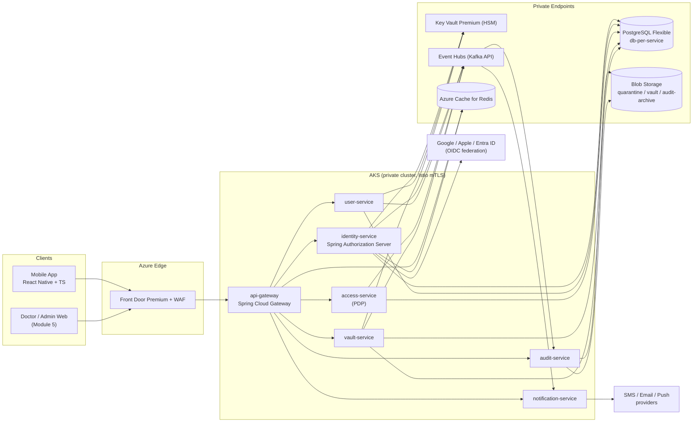
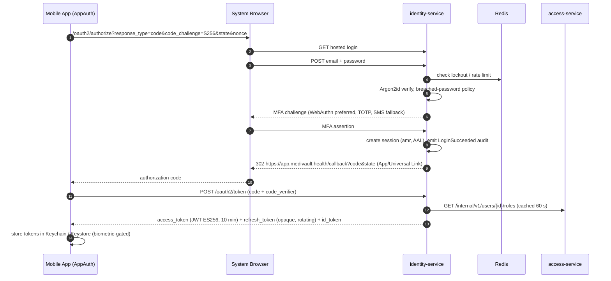
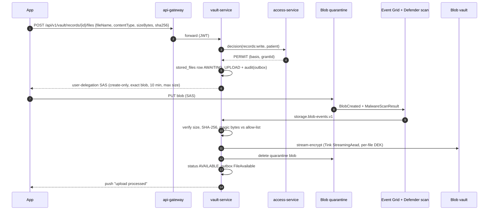
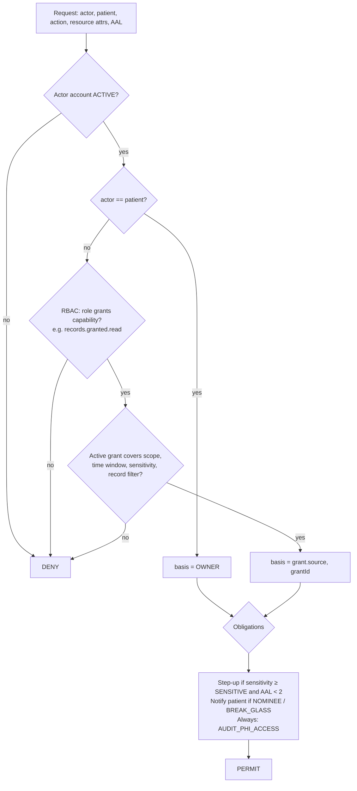
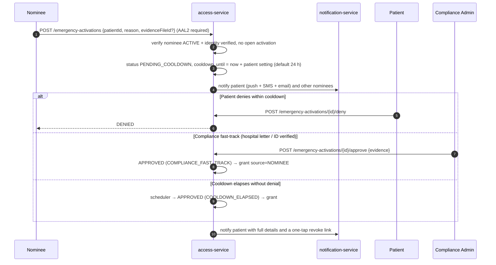
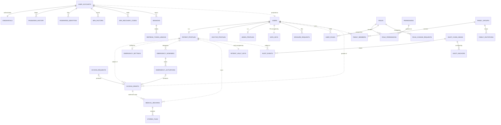
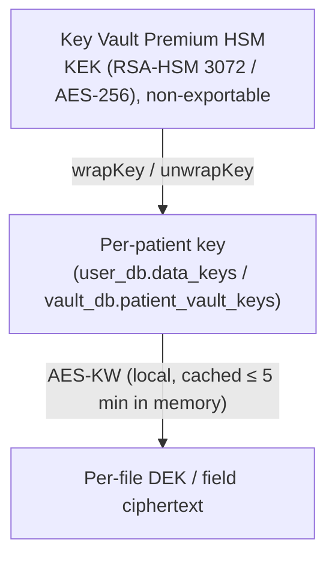
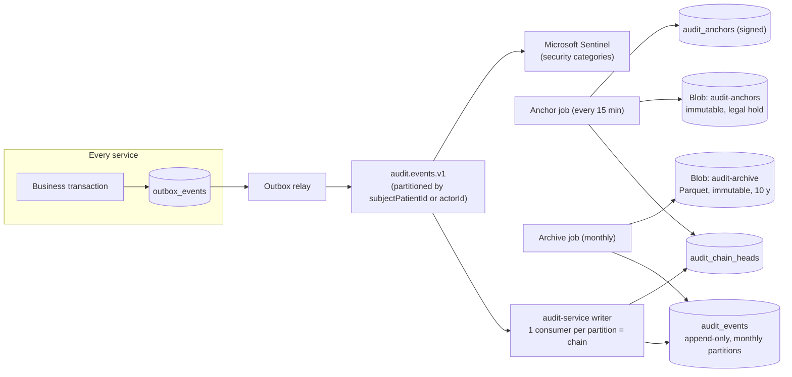
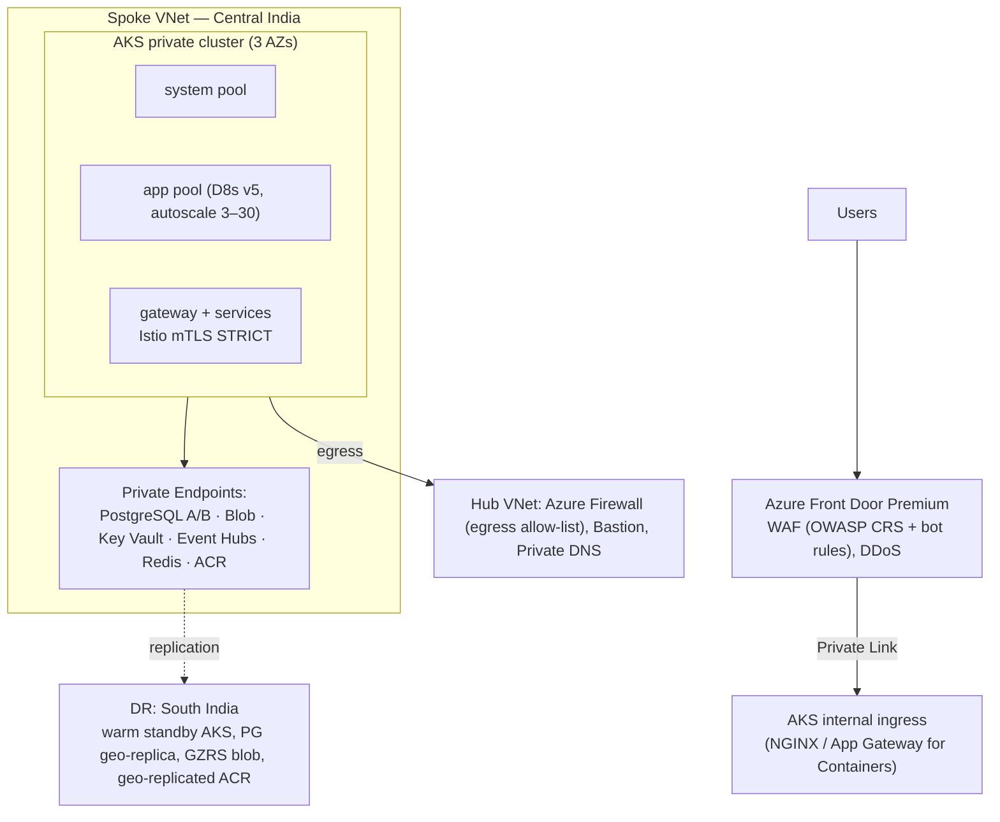

# MediVault AI — Module 1: Core Health Platform

> Production architecture · v1.0 · Owner: Platform Architecture
> Stack: React Native + TypeScript · Spring Boot microservices (Java 21) · PostgreSQL 16 · Azure Blob Storage · Azure Key Vault · AKS

---

## 1. Scope and Architectural Principles

Module 1 is the trust foundation that every later module (Emergency Case File, Medical Intelligence, Visual Triage, Operations) builds on. It owns **identity, authorization, profiles, relationships (family / nominees / doctors), the medical vault, files, audit and encryption.**

| # | Principle | Consequence |
|---|-----------|-------------|
| P1 | **Default deny, explicit basis** | Every PHI access resolves to `OWNER` or exactly one active grant; otherwise denied. |
| P2 | **Admins are not clinicians** | No admin role has a path to clinical content. Admins see account metadata only. |
| P3 | **No audit, no access** | The PHI-access audit event is written (outbox, same transaction) *before* PHI is returned. If the write fails, the request fails. |
| P4 | **Database per service** | Services own their data. Cross-service references are logical IDs plus events. No cross-DB joins. |
| P5 | **Envelope encryption everywhere** | HSM-backed KEKs in Key Vault, per-patient keys, per-file DEKs. Crypto-shredding for erasure. |
| P6 | **Zero trust inside the cluster** | mTLS between pods. Every service validates the JWT. Service-to-service calls use client-credentials tokens. |
| P7 | **Phishing-resistant by default for privileged users** | Doctors need MFA. Admins need WebAuthn/passkeys. Sensitive operations need step-up. |
| P8 | **Standards over invention** | OAuth 2.1 / OIDC, PKCE, RFC 7807, RFC 6238, WebAuthn L2, NIST 800-63B, OWASP ASVS L2 (L3 for auth and vault). |

**Compliance targets:** India DPDP Act 2023, ABDM health-data guidelines, HIPAA Security Rule (for US expansion), ISO 27001/27799. Data residency defaults to **Azure Central India**, with **South India** as the DR region.

---

## 2. System Context



---

## 3. Microservice Design

### 3.1 Service catalogue

| Service | Responsibility | Owns (DB) | Key integrations |
|---|---|---|---|
| **api-gateway** | TLS termination behind Front Door, JWT pre-validation, routing, rate limiting (Redis token bucket), request size limits, header hygiene, CORS for web | — (stateless) | Redis |
| **identity-service** | OAuth2/OIDC Authorization Server, hosted login and registration, password management, federation (Google / Apple / Entra ID), MFA (TOTP, WebAuthn, SMS fallback), sessions, refresh-token rotation, JWKS, account status | `identity_db` | Key Vault (signing keys, TOTP secret encryption), access-service (roles for tokens), Redis (challenges, lockout counters) |
| **user-service** | User directory, patient / doctor / admin profiles, dependents (managed minors), doctor verification workflow, erasure requests | `user_db` | Key Vault (field encryption), access-service (PDP), vault-service (licence documents) |
| **access-service** | RBAC (roles, permissions, assignments, four-eyes changes), ReBAC grants (consent, family, guardian, nominee, break-glass), Family Bridge, Emergency Nominee System, **Policy Decision Point** | `access_db` | user-service (identity proofing state), notification-service |
| **vault-service** | Medical records, file upload lifecycle (SAS → quarantine → scan → encrypt → store), streaming decryption on download, patient vault keys | `vault_db` | Blob Storage, Defender for Storage malware scanning, Key Vault, access-service |
| **audit-service** | Consumes audit events, writes the hash-chained append-only log, anchors chain heads to WORM storage, patient access log, compliance search and export | `audit_db` (isolated server) | Event Hubs, Blob (immutable), Key Vault (anchor signing), Sentinel export |
| **notification-service** | Push / SMS / email delivery, templates (no PHI in content), preferences, device tokens, delivery receipts | `notification_db` | FCM / APNs, SMS aggregator (DLT-registered), ACS Email |

All services use **Java 21, Spring Boot 3.x, Spring Security 6 (resource server), Spring Data JPA + Flyway, Spring Kafka, Micrometer + OpenTelemetry, and Resilience4j**.

### 3.2 Communication patterns

| Pattern | Used for | Technology |
|---|---|---|
| Synchronous request/response | User-facing APIs, PDP decisions | REST/JSON over mTLS. Internal paths `/internal/**` are never routed by the gateway. |
| Asynchronous domain events | Projections, notifications, audit, cache invalidation | Kafka protocol on Azure Event Hubs. **Transactional outbox** per service, relayed by a poller (Debezium is an alternative). |
| Service identity | Service-to-service auth | OAuth2 `client_credentials` from identity-service, plus Istio mTLS with SPIFFE identities. |
| Resilience | Downstream calls | Timeouts (≤ 2 s), retries with jitter (idempotent calls only), circuit breakers, bulkheads. The PDP **fails closed**. |

### 3.3 Event catalogue (topics are versioned and keyed by aggregate ID)

| Topic | Producer | Events | Consumers |
|---|---|---|---|
| `identity.account.v1` | identity | AccountRegistered, EmailVerified, AccountSuspended, AccountReactivated, MfaEnrolled, MfaReset, PasswordChanged | user, access, notification, audit |
| `user.profile.v1` | user | PatientProfileCreated/Updated, DoctorVerificationDecided, DependentCreated, ErasureRequested/Completed | access, vault, notification, audit |
| `access.grant.v1` | access | GrantCreated, GrantRevoked, GrantExpired, BreakGlassInvoked, RoleAssigned/Revoked | vault & user (PDP cache invalidation), notification, audit |
| `access.emergency.v1` | access | NomineeInvited/Accepted/Revoked, ActivationRequested/Denied/Approved/Expired | notification, audit |
| `vault.record.v1` | vault | RecordCreated/Updated/Deleted, FileAvailable, FileRejected | notification, audit, **Module 2 case-file engine** |
| `audit.events.v1` | all | AuditEvent (canonical schema, §10) | audit-service |
| `notification.requests.v1` | all | NotificationRequested | notification |
| `storage.blob-events.v1` | Event Grid | BlobCreated, MalwareScanResult | vault |

### 3.4 Key flows

#### 3.4.1 Login with MFA (OAuth 2.1 Authorization Code + PKCE, RFC 8252)



#### 3.4.2 Secure file upload



Rejected files (malware, type mismatch, size or hash mismatch) are deleted and marked `REJECTED`, and a security audit event is emitted. Unfinished uploads expire after 10 minutes, and a sweeper removes them.

#### 3.4.3 Authorization decision (PDP)



Decisions are cached in-process (Caffeine) for at most 30 s and are invalidated immediately by `access.grant.v1` events. So revocation takes effect in **≤ 1 s typical and ≤ 30 s worst case.**

#### 3.4.4 Emergency nominee activation



The resulting grant uses the patient's `emergency_settings`: default scopes are `emergency_card:read, profile:read, records:read`, and it expires after 72 h. `RESTRICTED` records are always excluded, and `SENSITIVE` records are included only if the patient opted in.

#### 3.4.5 Break-glass (verified doctors only)

The doctor calls `POST /break-glass-sessions` with `patientId`, a justification (≥ 30 characters) and a facility.

- **Preconditions:** `DOCTOR` role, `verification_status=VERIFIED`, and AAL2 or higher within the last 5 minutes.
- **Grant:** `source=BREAK_GLASS`, 4 h, scopes `emergency_card:read, profile:read, records:read` (no `RESTRICTED`), `review_status=PENDING`.
- **Side effects:** an immediate patient notification, and a compliance review queue item (SLA 72 h). An `UNJUSTIFIED` outcome triggers an escalation workflow and can suspend the doctor's break-glass capability.

---

## 4. Database Design

### 4.1 Topology

| Environment | Layout |
|---|---|
| dev | One PostgreSQL Flexible Server, one database per service |
| staging / prod | **Server A** (zone-redundant HA): `identity_db`, `user_db`, `access_db`, `vault_db`, `notification_db`. **Server B** (isolated, separate admin group): `audit_db` |

Each service connects with its own Entra ID-authenticated managed identity. There are no passwords and no cross-database grants.

### 4.2 Conventions

- **Primary keys:** UUIDv7 (time-ordered, index friendly), generated in the application.
- **Columns:** `timestamptz` everywhere. `version` for optimistic locking (exposed as `ETag`). Soft delete with `deleted_at` where business-relevant.
- **Sensitive columns:**
  - `_enc` columns hold AES-256-GCM ciphertext. The AAD (additional authenticated data) is `table:column:row_id`, which prevents ciphertext swapping between rows.
  - `_bidx` columns hold a normalized HMAC-SHA256 blind index for exact-match lookups.
- **Migrations:** Flyway in `src/main/resources/db/migration`, with expand/contract for zero-downtime changes.
- **Outbox:** every service has `outbox_events`, written in the same transaction as the state change.

### 4.3 Table catalogue

| DB | Tables | DDL |
|---|---|---|
| identity_db | user_accounts, credentials, password_history, federated_identities, mfa_factors, mfa_recovery_codes, sessions, refresh_token_lineage, SAS tables (`oauth2_*`), outbox_events | [identity V1](./db/identity-service/V1__init.sql) |
| user_db | data_keys, users, patient_profiles, doctor_profiles, admin_profiles, erasure_requests, outbox_events | [user V1](./db/user-service/V1__init.sql) |
| access_db | roles, permissions, role_permissions, user_roles, role_change_requests, family_groups, family_members, family_invitations, access_grants, access_requests, emergency_settings, emergency_nominees, emergency_activations, outbox_events (+ seed RBAC) | [access V1](./db/access-service/V1__init.sql) |
| vault_db | patient_vault_keys, medical_records, stored_files, outbox_events | [vault V1](./db/vault-service/V1__init.sql) |
| audit_db | audit_events (partitioned, immutable), audit_chain_heads, audit_anchors, audit_export_jobs | [audit V1](./db/audit-service/V1__init.sql) |

### 4.4 Integrity rules enforced in the database (not only in code)

- `access_grants`: break-glass needs a justification, an expiry and a review status. Consent, nominee and break-glass grants always expire.
- `role_change_requests` and `admin_profiles`: the approver must not be the requester (four-eyes).
- `emergency_nominees`: a patient can't nominate themselves. Priorities are unique among live nominees.
- `emergency_activations`: at most one open activation per patient/nominee pair. `APPROVED` requires a grant.
- `stored_files`: `AVAILABLE` requires a wrapped DEK, a blob path and a verified hash.
- `audit_events`: triggers block UPDATE and DELETE. The application role only has INSERT and SELECT.

---

## 5. ER Diagram

Solid lines are physical FKs inside a database. Dotted lines are logical cross-service references (ID plus events).



---

## 6. Folder Structure

### 6.1 Monorepo

```text
medivault/
├── apps/
│   └── mobile/                          # React Native + TypeScript
├── services/
│   ├── api-gateway/
│   ├── identity-service/
│   ├── user-service/
│   ├── access-service/
│   ├── vault-service/
│   ├── audit-service/
│   └── notification-service/
├── libs/
│   ├── platform-bom/                    # pinned dependency versions
│   ├── common-web/                      # RFC 7807 errors, pagination, idempotency filter, ETag
│   ├── common-security/                 # resource-server config, AAL checks, PDP client, @PhiAccess aspect
│   ├── common-crypto/                   # envelope encryption, AAD binding, blind index, Key Vault adapter
│   ├── common-audit/                    # AuditEvent model + outbox emitter
│   ├── common-outbox/                   # transactional outbox + relay
│   └── contracts/                       # OpenAPI 3.1, AsyncAPI, JSON Schemas for events
├── infra/
│   ├── terraform/{modules,envs/dev,envs/staging,envs/prod}
│   ├── helm/medivault-service/          # one chart, per-service values
│   └── argocd/                          # ApplicationSets
├── docs/
├── .github/workflows/
├── settings.gradle.kts
└── build.gradle.kts
```

### 6.2 Service layout (hexagonal, shown for vault-service)

```text
services/vault-service/
├── build.gradle.kts
└── src/
    ├── main/java/health/medivault/vault/
    │   ├── VaultServiceApplication.java
    │   ├── api/                          # controllers, DTOs, mappers, exception handlers
    │   │   ├── RecordController.java
    │   │   ├── FileController.java
    │   │   └── dto/
    │   ├── application/                  # use cases (transaction boundaries) + ports
    │   │   ├── CreateRecordUseCase.java
    │   │   ├── InitiateUploadUseCase.java
    │   │   ├── IngestScannedBlobUseCase.java
    │   │   ├── StreamFileUseCase.java
    │   │   └── port/ {AccessDecisionPort, BlobStoragePort, KeyWrappingPort, AuditPort}
    │   ├── domain/                       # aggregates, value objects, invariants, domain events
    │   │   ├── MedicalRecord.java
    │   │   ├── StoredFile.java  FileStatus.java  Sensitivity.java
    │   ├── infrastructure/
    │   │   ├── persistence/              # JPA entities + repositories
    │   │   ├── blob/                     # AzureBlobAdapter, UserDelegationSasFactory
    │   │   ├── crypto/                   # StreamingEnvelopeCipher (Tink)
    │   │   ├── messaging/                # Kafka listeners, outbox relay
    │   │   └── client/                   # AccessServiceClient (Resilience4j)
    │   └── config/                       # SecurityConfig, KafkaConfig, ObservabilityConfig
    ├── main/resources/
    │   ├── application.yml
    │   └── db/migration/V1__init.sql
    └── test/java/...                     # unit, Testcontainers ITs, Spring Cloud Contract
```

### 6.3 Mobile app

```text
apps/mobile/
├── package.json  tsconfig.json  app.config.ts
├── ios/  android/
├── src/
│   ├── app/                    # App.tsx, providers, navigation (AuthStack, PatientTabs, DoctorTabs)
│   ├── features/
│   │   ├── auth/               # AppAuth login, MFA enrollment, passkeys, session list
│   │   ├── profile/            # patient / doctor / admin profile screens
│   │   ├── family/             # groups, invitations, dependents
│   │   ├── nominees/           # nominee management, emergency activation
│   │   ├── access/             # grants, access requests, break-glass (doctor)
│   │   ├── vault/              # records list/detail, upload, secure viewer
│   │   └── audit/              # "who accessed my data"
│   │   # each feature: api.ts · hooks.ts · screens/ · components/ · schema.ts (zod) · types.ts
│   ├── shared/
│   │   ├── api/                # OpenAPI-generated client, auth interceptor, retry, idempotency keys
│   │   ├── security/           # tokenStore (react-native-keychain), biometric lock, pinning, integrity
│   │   ├── state/              # TanStack Query, zustand session store
│   │   ├── ui/                 # design system
│   │   └── i18n/
│   └── types/
├── e2e/                        # Detox
└── __tests__/
```

---

## 7. API Specifications

### 7.1 Conventions

| Topic | Rule |
|---|---|
| Base path | `/api/v1/...`, versioned in the path. Internal APIs use `/internal/v1/...` and are not exposed by the gateway. |
| Format | JSON, camelCase. UUIDv7 IDs. ISO-8601 UTC timestamps. |
| Pagination | Cursor based: `?limit=50&cursor=...` returns `{items, nextCursor}` |
| Concurrency | `ETag` on GET, `If-Match` required on PUT/PATCH/DELETE (412 on mismatch) |
| Idempotency | `Idempotency-Key` header is mandatory on creating POSTs (24 h replay window, Redis) |
| Errors | RFC 7807 `application/problem+json` with `type`, `title`, `status`, `detail`, `instance`, `traceId`, `errors[]` |
| Tracing | W3C `traceparent` propagated end to end |
| Step-up | `401` with `WWW-Authenticate: Bearer error="insufficient_user_authentication", acr_values="urn:medivault:aal2", max_age=300` (RFC 9470) |
| Secrets in URLs | Never. Invitation and reset tokens travel in request bodies. |
| Contracts | OpenAPI 3.1 in `libs/contracts`. The TS client is generated for mobile. Contract tests run in CI. |

### 7.2 identity-service

| Method | Path | Auth | Purpose |
|---|---|---|---|
| GET | `/.well-known/openid-configuration`, `/oauth2/jwks` | public | Discovery, signing keys |
| GET | `/oauth2/authorize` | public | Auth code + PKCE (supports `acr_values`, `max_age`, `prompt=login`) |
| POST | `/oauth2/token` | client | `authorization_code`, `refresh_token`, `client_credentials` (services) |
| POST | `/oauth2/revoke` · `/connect/logout` | user | Revoke token / end session |
| GET | `/userinfo` | user | OIDC claims (no PHI) |
| POST | `/api/v1/identity/registrations` | public | Register (email, password, userType ∈ PATIENT, DOCTOR) |
| POST | `/api/v1/identity/registrations/verify-email` | public | `{token}` |
| POST | `/api/v1/identity/password/forgot` · `/password/reset` | public | Always returns 202 (no account enumeration) |
| PUT | `/api/v1/identity/password` | user, AAL2 | Change password |
| GET | `/api/v1/identity/mfa/factors` | user | List factors |
| POST | `/api/v1/identity/mfa/factors/totp` | user | Start TOTP enrolment, returns `otpauth://` URI |
| POST | `/api/v1/identity/mfa/factors/webauthn/registration-options` | user | WebAuthn options |
| POST | `/api/v1/identity/mfa/factors/webauthn` | user | Register passkey |
| POST | `/api/v1/identity/mfa/factors/{id}/activate` | user | Verify first code / assertion |
| DELETE | `/api/v1/identity/mfa/factors/{id}` | user, AAL2 | Remove factor (the last factor can't be removed if MFA is mandatory) |
| POST | `/api/v1/identity/mfa/recovery-codes` | user, AAL2 | Regenerate 10 codes (shown once) |
| GET | `/api/v1/identity/sessions` | user | Active devices |
| DELETE | `/api/v1/identity/sessions/{id}` · POST `/sessions/revoke-others` | user | Sign out devices |
| GET | `/api/v1/identity/admin/accounts` | `admin.users.read` | Search accounts (metadata only) |
| POST | `/api/v1/identity/admin/accounts/{id}/suspend` · `/reactivate` | `admin.users.suspend` | With reason |
| POST | `/api/v1/identity/admin/accounts/{id}/mfa-reset-requests` | `admin.mfa.reset.request` | Four-eyes step 1 |
| POST | `/api/v1/identity/admin/mfa-reset-requests/{id}/approve` | `admin.mfa.reset.approve` | Four-eyes step 2 |
| POST | `/api/v1/identity/admin/accounts/{id}/sessions/revoke` | `security.sessions.revoke` | Kill all sessions |

### 7.3 user-service

| Method | Path | Auth | Purpose |
|---|---|---|---|
| GET / PATCH | `/api/v1/users/me` | user | Directory record (display name, locale, phone) |
| POST | `/api/v1/users/me/erasure-request` | user, AAL2 | DPDP erasure, with a cooling-off period |
| POST | `/api/v1/patients/me` | PATIENT | Create patient profile (onboarding) |
| GET / PUT | `/api/v1/patients/me` | PATIENT | Own profile |
| GET | `/api/v1/patients/{patientId}` | PDP `profile:read` | Granted view |
| GET | `/api/v1/patients/{patientId}/emergency-card` | PDP `emergency_card:read` | Blood group, allergies, conditions, meds, nominee contacts |
| POST / GET | `/api/v1/patients/me/dependents` | PATIENT | Create or list managed minors (guardian grant created automatically) |
| POST / GET / PUT | `/api/v1/doctors/me` | DOCTOR | Apply / view / update the professional profile |
| GET | `/api/v1/doctors?specialization=&q=` | `doctor.directory.read` | Verified doctors only |
| GET | `/api/v1/doctors/{doctorId}` | `doctor.directory.read` | Public professional profile |
| GET | `/api/v1/admin/users?q=&type=&status=` | `admin.users.read` | Metadata only, never PHI |
| GET | `/api/v1/admin/doctor-verifications?status=PENDING` | `admin.doctors.verify` | Review queue |
| POST | `/api/v1/admin/doctor-verifications/{doctorId}/decision` | `admin.doctors.verify` | `{decision: VERIFIED\|REJECTED, notes}` (verifier ≠ doctor) |

### 7.4 access-service

| Method | Path | Auth | Purpose |
|---|---|---|---|
| POST / GET | `/api/v1/family-groups` | `family.manage` | Create / list my groups |
| GET / PATCH | `/api/v1/family-groups/{groupId}` | group member / admin | Details / rename |
| POST | `/api/v1/family-groups/{groupId}/invitations` | group admin, AAL2 | Invite by email or phone with proposed scopes |
| POST | `/api/v1/family-invitations/accept` | user | `{token}` (single use, 7-day expiry) |
| PATCH / DELETE | `/api/v1/family-groups/{groupId}/members/{memberId}` | group admin | Change role or scopes / remove |
| GET | `/api/v1/patients/{patientId}/grants` | owner / guardian | List grants on my data |
| POST | `/api/v1/patients/{patientId}/grants` | owner / guardian, AAL2 | Grant scopes to a user, doctor or family group |
| DELETE | `/api/v1/grants/{grantId}` | owner / guardian / grantee | Revoke (immediate cache invalidation) |
| GET | `/api/v1/grants/received` | user | Access I hold |
| POST | `/api/v1/access-requests` | DOCTOR (verified) | Request consent `{patientId, scopes, purpose, requestedMinutes}` |
| GET | `/api/v1/access-requests?as=patient\|requester&status=` | user | Inbox / outbox |
| POST | `/api/v1/access-requests/{id}/approve` · `/deny` | patient, AAL2 | Approve (optionally narrowing scope or duration) |
| POST | `/api/v1/break-glass-sessions` | `break_glass.invoke`, AAL2 ≤ 5 min | Emergency access, 4 h |
| GET / POST | `/api/v1/admin/break-glass-reviews` · `/{grantId}` | `admin.break_glass.review` | Review queue / outcome |
| GET / PUT | `/api/v1/emergency-settings` | PATIENT | Cooldown, duration, default scopes |
| GET / POST | `/api/v1/nominees` | `nominee.manage` (POST: AAL2) | List / invite nominee (max 5, ordered priority) |
| PATCH / DELETE | `/api/v1/nominees/{id}` | `nominee.manage`, AAL2 | Reprioritize / revoke |
| POST | `/api/v1/nominee-invitations/accept` | user | `{token}`, then identity verification |
| GET | `/api/v1/nominations` | user | Patients who nominated me |
| POST | `/api/v1/emergency-activations` | `emergency.request`, AAL2 | Start activation |
| GET | `/api/v1/emergency-activations/{id}` | patient / nominee / compliance | Status |
| POST | `/api/v1/emergency-activations/{id}/deny` · `/approve` · `/revoke` | patient (deny / approve / revoke), `admin.emergency.adjudicate` (approve) | Decisions |
| GET | `/api/v1/admin/roles` · `/admin/permissions` · `/admin/role-assignments?userId=` | `admin.users.read` | RBAC read |
| POST | `/api/v1/admin/role-change-requests` | `admin.roles.request` | Four-eyes step 1 (justification required) |
| POST | `/api/v1/admin/role-change-requests/{id}/approve` · `/reject` | `admin.roles.approve` (≠ requester) | Four-eyes step 2 |
| POST | `/internal/v1/access/decisions` (+ `:batch`) | service token | PDP |
| GET | `/internal/v1/users/{userId}/roles` | service token | Roles for token issuance |

### 7.5 vault-service

| Method | Path | Auth | Purpose |
|---|---|---|---|
| GET | `/api/v1/vault/patients/{patientId}/records?type=&from=&to=&tag=&cursor=` | PDP `records:read` | List (sensitivity-filtered per basis) |
| POST | `/api/v1/vault/patients/{patientId}/records` | PDP `records:write` | Create record |
| GET / PATCH / DELETE | `/api/v1/vault/records/{recordId}` | PDP read / write; DELETE owner only | Detail / amend (If-Match) / soft delete |
| POST | `/api/v1/vault/records/{recordId}/files` | PDP `records:write` | Initiate upload, returns SAS |
| POST | `/api/v1/vault/files` | user | Non-record uploads (`DOCTOR_LICENSE`, `EMERGENCY_EVIDENCE`, `AVATAR`) |
| GET | `/api/v1/vault/files/{fileId}` | PDP `records:read` | Metadata and processing status |
| GET | `/api/v1/vault/files/{fileId}/content` | PDP `files:download` (+ AAL2 for SENSITIVE+) | Streamed decryption, `Cache-Control: no-store` |
| DELETE | `/api/v1/vault/files/{fileId}` | owner | Delete (blob plus wrapped DEK destroyed) |

### 7.6 audit-service and notification-service

| Method | Path | Auth | Purpose |
|---|---|---|---|
| GET | `/api/v1/audit/me/access-log?from=&to=&cursor=` | `audit.own.read` | Who accessed my data, when, on what basis |
| GET | `/api/v1/audit/me/security-activity` | user | My logins, MFA changes, sessions |
| GET | `/api/v1/audit/admin/events?actorId=&patientId=&category=&action=&from=&to=` | `audit.search` | Compliance search (the query itself is audited) |
| POST / GET | `/api/v1/audit/admin/exports` · `/{id}` | `audit.export` (approved by a second compliance admin) | Async signed export |
| GET | `/api/v1/audit/admin/integrity?chainId=&fromSeq=&toSeq=` | `audit.integrity.verify` | Re-verify the hash chain against anchors |
| GET / PUT | `/api/v1/notifications/preferences` | user | Channels, quiet hours (critical alerts bypass) |
| POST / DELETE | `/api/v1/notifications/devices` | user | Register / remove a push token |

### 7.7 Representative payloads

**Initiate upload**

```http
POST /api/v1/vault/records/0192f1a2-.../files
Idempotency-Key: 7c0e...
Content-Type: application/json

{ "fileName": "cbc-2026-10-20.pdf", "contentType": "application/pdf",
  "sizeBytes": 482113, "sha256": "b64:Qm9...=" }
```
```json
201 Created
{ "fileId": "0192f1a3-...", "status": "AWAITING_UPLOAD",
  "upload": { "method": "PUT", "url": "https://stmvquarantine.blob.core.windows.net/q/0192f1a3-...?sv=...&sig=...",
              "headers": { "x-ms-blob-type": "BlockBlob", "Content-Type": "application/pdf" },
              "expiresAt": "2026-10-24T17:05:00Z", "maxSizeBytes": 482113 } }
```

**PDP decision (internal)**

```json
POST /internal/v1/access/decisions
{ "actorId": "0192...", "actorRoles": ["DOCTOR"], "patientId": "0191...",
  "action": "records:read",
  "resource": { "type": "MEDICAL_RECORD", "id": "0192...", "sensitivity": "SENSITIVE", "recordType": "LAB_REPORT" },
  "context": { "aal": 2, "authTime": "2026-10-24T16:51:02Z", "sessionId": "0192..." } }

200 OK
{ "decision": "PERMIT", "basis": "CONSENT", "grantId": "0192...",
  "obligations": ["AUDIT_PHI_ACCESS"], "ttlSeconds": 30 }
```

**Error (RFC 7807)**

```json
403 application/problem+json
{ "type": "https://errors.medivault.health/access-denied", "title": "Access denied",
  "status": 403, "detail": "No active grant covers records:read for this patient.",
  "instance": "/api/v1/vault/records/0192...", "traceId": "4bf92f3577b34da6a3ce929d0e0e4736" }
```

---

## 8. Security Design

### 8.1 Authentication and tokens

| Control | Design |
|---|---|
| Protocol | OAuth 2.1 / OIDC through Spring Authorization Server. Mobile uses Authorization Code + PKCE (S256) in the system browser via AppAuth, with redirects on claimed **App Links / Universal Links**. No ROPC and no implicit flow. |
| Federation | Google, Apple (patients), Microsoft Entra ID (hospital staff / admins, with Conditional Access). Accounts are linked only after email verification on both sides. |
| Access token | JWT, **ES256**, 10 min, `aud=medivault-api`. Private keys are non-exportable in Key Vault Premium (HSM). Rotated every 90 days; JWKS publishes current and previous keys (`kid`). |
| Refresh token | Opaque, 256-bit, stored as SHA-256 only. **Rotated on every use**; reuse of a consumed token revokes the session (token family). Idle 14 days / absolute 30 days for patients, 12 h for doctors, 8 h for admins. |
| Claims | `iss sub aud exp iat jti sid client_id scope roles user_type acr amr auth_time`. **No PHI and no per-patient grants in tokens.** |
| Passwords | NIST 800-63B: minimum 12 characters, no composition rules, breached-password check (k-anonymity range API), Argon2id (m=64 MiB, t=3, p=1), history of 5. |
| Brute force | Per-account and per-IP rate limits (Redis). Progressive delay, then a 15-minute lock after 10 failures. CAPTCHA after 3 failures on web. |
| Service identity | `client_credentials` tokens (5 min) with audience-restricted scopes, plus Istio mTLS. |

Example access-token payload:

```json
{ "iss": "https://auth.medivault.health", "sub": "0192f0c4-7b1e-7c55-9a0e-3c1f2d4e5a6b",
  "aud": ["medivault-api"], "exp": 1792857600, "iat": 1792857000, "jti": "0192f0c5-...",
  "sid": "0192f0c4-9d...", "client_id": "medivault-mobile", "scope": "openid profile vault",
  "roles": ["PATIENT"], "user_type": "PATIENT",
  "acr": "urn:medivault:aal2", "amr": ["pwd", "hwk"], "auth_time": 1792856990 }
```

### 8.2 MFA policy

| Population | Requirement |
|---|---|
| Patient | Optional but prompted at onboarding. **Required** before granting access, managing nominees or downloading SENSITIVE+ files (step-up). |
| Nominee / family member holding grants | AAL2 required to use emergency or `records:*` grants |
| Doctor | Mandatory MFA (WebAuthn or TOTP). Break-glass requires AAL2 within the last 5 minutes. |
| Admin (all levels) | Mandatory **WebAuthn/passkey (AAL3)**, Entra ID Conditional Access (compliant device), IP allow-list, 8 h sessions, 15 min idle timeout |
| SMS OTP | Patient fallback only. Rate-limited, never available to admins. SIM-swap risk accepted only at AAL2-low for patients. |
| Recovery | 10 single-use Argon2id-hashed codes. Admin-assisted MFA reset requires four-eyes approval plus identity re-verification. |

### 8.3 Authorization model

- **RBAC** (coarse capabilities): `PATIENT`, `DOCTOR`, `ADMIN_SUPPORT`, `ADMIN_COMPLIANCE`, `ADMIN_SECURITY`, `SUPER_ADMIN`. Permissions are seeded in `access_db`.
- **ReBAC grants** (fine-grained, per patient): sources `CONSENT | FAMILY | GUARDIAN | NOMINEE | BREAK_GLASS`. Grant scopes are listed below.
- **ABAC conditions:** record sensitivity, record type filters, time windows, AAL, account status, doctor verification status.
- **Enforcement:**
  - The gateway enforces authentication.
  - Each service enforces RBAC with `@PreAuthorize`.
  - Patient-scoped data is checked through the PDP via the `@PhiAccess` aspect in `common-security`.
  - List endpoints use the batch decision API plus SQL-level patient filters.
  - Repository methods require `patientId`, so there are no unscoped queries.

Grant scopes:

| Scope | Allows |
|---|---|
| `emergency_card:read` | View the patient's emergency card |
| `profile:read` | View the patient profile |
| `records:read` | Read medical records |
| `records:read_sensitive` | Read SENSITIVE records |
| `records:write` | Add records |
| `files:download` | Download files |
| `audit:read` | Read the patient's access log |
| `delegate:manage` | Guardian only: manage on the patient's behalf |

### 8.4 Encryption

| Layer | Mechanism |
|---|---|
| In transit (external) | TLS 1.3 (TLS 1.2 minimum, strong suites) at Front Door, HSTS preload. The mobile app pins the intermediate CA public keys (2 pins plus a backup). |
| In transit (internal) | Istio STRICT mTLS. TLS to PostgreSQL, Redis, Event Hubs and Blob over Private Endpoints. |
| At rest (platform) | Azure SSE with **customer-managed keys** for PostgreSQL, Blob, Event Hubs, managed disks and Redis. |
| Application field-level | AES-256-GCM via `common-crypto`, keyed by the per-user `data_keys` row. AAD binds ciphertext to table, column and row. |
| Files | Tink **StreamingAead AES256_GCM_HKDF_1MB** with a per-file DEK, wrapped by the per-patient vault key, which is wrapped by an HSM KEK. |
| Blind indexes | HMAC-SHA256 with a dedicated Key Vault key per index type, over normalized input (E.164 phone, Aadhaar digits). |
| Secrets | None in code or config. Workload Identity is used for Key Vault, PostgreSQL (Entra auth), Event Hubs and Blob. |



**Key rotation:**
- KEKs rotate every 12 months. Rewrapping patient keys is a background job; data is not re-encrypted.
- Patient keys rotate on demand or on suspected compromise.
- JWT signing keys rotate every 90 days.

**Crypto-shredding:** an erasure request (after cooling-off and legal-hold checks) destroys the patient's keys and deletes blobs. Ciphertext that remains in backups becomes unrecoverable. The audit trail keeps pseudonymous IDs as legally required.

### 8.5 Application security controls

- **Standards and testing:** OWASP ASVS L2 baseline, L3 for identity and vault. Threat modelling (STRIDE) per feature.
- **Input and data handling:**
  - Bean Validation on every DTO.
  - Explicit allow-list for file MIME types (PDF, JPEG, PNG, HEIC, DICOM in a later phase), checked by magic bytes.
  - Max 100 MB per file.
  - Downloads use `Content-Disposition: attachment` and `X-Content-Type-Options: nosniff`.
- **Resource and token safety:**
  - No sequential IDs (UUIDv7).
  - Ownership is checked on every object (no IDOR).
  - Tokens are never in URLs. Logs are scrubbed of PHI and tokens (Logback masking plus a Fluent Bit redaction filter).
- **CI security tooling:** CodeQL (SAST), OWASP Dependency-Check / Dependabot (SCA), gitleaks (secrets), Trivy (images), ZAP baseline (DAST, staging).

### 8.6 Mobile security

| Threat | Control |
|---|---|
| Token theft | Tokens are stored only in Keychain (iOS, `kSecAttrAccessibleWhenUnlockedThisDeviceOnly`) or Android Keystore (StrongBox where available), via react-native-keychain. Biometric unlock is required to use the refresh token. |
| Device compromise | Play Integrity API / App Attest checks are sent to identity-service on login. Rooted or jailbroken devices get degraded access (no downloads). |
| Data at rest on device | No PHI in AsyncStorage. Cached files live in an encrypted app sandbox (Module 5 offline DB uses SQLCipher). Auto-lock after 5 minutes in background. |
| Shoulder surfing / screenshots | `FLAG_SECURE` on Android; iOS hides content in the app switcher on sensitive screens. |
| MITM | Certificate pinning, no cleartext traffic (ATS / network security config). |
| Reverse engineering | Hermes bytecode, R8/ProGuard, no secrets in the bundle (public OAuth client with PKCE only). |

### 8.7 Threat model summary (STRIDE)

| Threat | Example | Mitigation |
|---|---|---|
| Spoofing | Credential stuffing | Breached-password checks, rate limits, MFA, passkeys |
| Tampering | Audit log modification | DB triggers, INSERT-only role, hash chain, WORM anchors |
| Repudiation | A doctor denies a break-glass access | Signed audit with session, device, IP and justification |
| Information disclosure | IDOR on records | PDP on every object, patient-scoped repositories, UUIDs |
| Denial of service | Upload flooding | Rate limits, SAS size caps, quotas per patient, WAF |
| Elevation of privilege | An admin grants themselves a role | Four-eyes in a DB constraint, PIM, role changes audited and alerted |

---

## 9. Access Matrix

**Legend:**
- ✅ allowed
- 🔶 only with an active grant containing that scope
- 🟡 limited (detail in notes)
- ❌ denied

All PHI access is audited. Nominee and break-glass access notify the patient.

| Action | Patient (self) | Guardian | Family (granted) | Nominee (approved activation) | Doctor (consent) | Doctor (break-glass) | Support Admin | Compliance Admin | Security Admin | Super Admin |
|---|---|---|---|---|---|---|---|---|---|---|
| View profile / demographics | ✅ | ✅ | 🔶 `profile:read` | ✅ | 🔶 | ✅ | 🟡 name, email, status | 🟡 same | 🟡 same | 🟡 same |
| Edit patient profile | ✅ | ✅ | ❌ | ❌ | ❌ | ❌ | ❌ | ❌ | ❌ | ❌ |
| View emergency card | ✅ | ✅ | 🔶 | ✅ | 🔶 | ✅ | ❌ | ❌ | ❌ | ❌ |
| Read NORMAL records | ✅ | ✅ | 🔶 `records:read` | ✅ | 🔶 | ✅ | ❌ | ❌ | ❌ | ❌ |
| Read SENSITIVE records | ✅ AAL2 | ✅ AAL2 | 🔶 `records:read_sensitive` | 🟡 only if patient opted in | 🔶 explicit | ❌ | ❌ | ❌ | ❌ | ❌ |
| Read RESTRICTED records | ✅ AAL2 | 🟡 jurisdiction policy for adolescents | ❌ | ❌ | 🔶 per-record grant only | ❌ | ❌ | ❌ | ❌ | ❌ |
| Download files | ✅ | ✅ | 🔶 `files:download` | ✅ | 🔶 | ✅ | ❌ | ❌ | ❌ | ❌ |
| Add records | ✅ | ✅ | 🔶 `records:write` | ❌ | 🔶 `records:write` | 🟡 clinical note, flagged | ❌ | ❌ | ❌ | ❌ |
| Delete records | ✅ (soft) | ✅ | ❌ | ❌ | ❌ (amend only) | ❌ | ❌ | ❌ | ❌ | ❌ |
| Grant / revoke access | ✅ AAL2 | ✅ AAL2 | ❌ | ❌ | ❌ | ❌ | ❌ | ❌ | ❌ | ❌ |
| Manage family groups | ✅ | ✅ | 🟡 own membership | ❌ | ❌ | ❌ | ❌ | ❌ | ❌ | ❌ |
| Manage nominees / emergency settings | ✅ AAL2 | ✅ AAL2 | ❌ | ❌ | ❌ | ❌ | ❌ | ❌ | ❌ | ❌ |
| Request emergency activation | — | — | — | ✅ (as nominee) | — | — | ❌ | ❌ | ❌ | ❌ |
| Approve emergency activation | ✅ (own) | ✅ | ❌ | ❌ | ❌ | ❌ | ❌ | ✅ fast-track with evidence | ❌ | ❌ |
| Invoke break-glass | — | — | — | — | — | ✅ verified doctors | ❌ | ❌ | ❌ | ❌ |
| View own data's access log | ✅ | ✅ | 🔶 `audit:read` | ❌ | ❌ | ❌ | ❌ | ✅ (search, audited) | 🟡 security events | ❌ |
| Suspend / reactivate accounts | — | — | — | — | — | — | ✅ non-admin | ❌ | ✅ any | ❌ |
| Reset another user's MFA | — | — | — | — | — | — | ✅ request | ❌ | ✅ approve | ❌ |
| Verify doctors | — | — | — | — | — | — | ❌ | ✅ | ❌ | ❌ |
| Request role change | — | — | — | — | — | — | ❌ | ❌ | ❌ | ✅ |
| Approve role change | — | — | — | — | — | — | ❌ | ❌ | ✅ (≠ requester) | ✅ (≠ requester) |
| Review break-glass | — | — | — | — | — | — | ❌ | ✅ | ❌ | ❌ |
| Export audit log | — | — | — | — | — | — | ❌ | ✅ with second approver | ❌ | ❌ |
| Revoke any session | — | — | — | — | — | — | ❌ | ❌ | ✅ | ❌ |

**Separation of duties:**
- Super Admin can't read audit content or clinical data.
- Compliance can't change roles.
- Security can't verify doctors.
- No single admin can both request and approve a privileged change.

---

## 10. Audit Architecture

### 10.1 Flow



### 10.2 Canonical event

```json
{ "id": "0192f0d1-...", "occurredAt": "2026-10-24T16:58:11.402Z", "sourceService": "vault-service",
  "category": "PHI_ACCESS", "action": "FILE_DOWNLOADED", "outcome": "SUCCESS",
  "actor": { "id": "0192...", "type": "USER", "roles": ["DOCTOR"], "sessionId": "0192...",
             "ip": "203.0.113.24", "userAgent": "MediVault/1.4.0 (Android 15)", "deviceId": "a1b2..." },
  "onBehalfOf": null, "subjectPatientId": "0191...",
  "resource": { "type": "STORED_FILE", "id": "0192..." },
  "accessBasis": "CONSENT", "grantId": "0192...", "traceId": "4bf92f35...",
  "details": { "sensitivity": "NORMAL", "bytes": 482113 } }
```

`details` must never contain PHI values (names, results, notes). A schema validator in `common-audit` enforces this with an allow-list of keys per action.

### 10.3 What is audited

| Category | Actions (non-exhaustive) |
|---|---|
| AUTHENTICATION | LOGIN_SUCCEEDED/FAILED, MFA_CHALLENGE_FAILED, TOKEN_REFRESH_REUSE_DETECTED, LOGOUT, PASSWORD_CHANGED/RESET |
| AUTHORIZATION | ACCESS_DENIED (PDP), STEP_UP_REQUIRED |
| PHI_ACCESS | PROFILE_VIEWED, EMERGENCY_CARD_VIEWED, RECORD_VIEWED, RECORD_LISTED, FILE_DOWNLOADED |
| PHI_CHANGE | RECORD_CREATED/AMENDED/DELETED, PROFILE_UPDATED, FILE_UPLOADED/REJECTED |
| CONSENT | GRANT_CREATED/REVOKED/EXPIRED, ACCESS_REQUEST_DECIDED, FAMILY_MEMBER_ADDED/REMOVED |
| EMERGENCY | NOMINEE_INVITED/ACCEPTED/REVOKED, ACTIVATION_REQUESTED/DENIED/APPROVED, BREAK_GLASS_INVOKED/REVIEWED |
| ADMIN | ACCOUNT_SUSPENDED, DOCTOR_VERIFIED, ROLE_CHANGE_REQUESTED/APPROVED, MFA_RESET_APPROVED, AUDIT_SEARCHED, AUDIT_EXPORTED |
| SECURITY | KEY_ROTATED, INTEGRITY_CHECK_FAILED, MALWARE_DETECTED, RATE_LIMIT_TRIPPED |

### 10.4 Tamper evidence

- **Per chain** (one chain per Kafka partition): `hash_n = SHA-256(hash_{n-1} ‖ canonical_json(event_n))`, using RFC 8785 JSON Canonicalization.
- **Writer:** in one transaction it runs `SELECT ... FOR UPDATE` on `audit_chain_heads`, inserts the event, and updates the head. It is idempotent on event `id`.
- **Anchoring:** every 15 minutes the chain heads are signed with a Key Vault key and written to an **immutable Blob container** (time-based retention plus legal hold). Their references are stored in `audit_anchors`.
- **Verification:** a nightly job recomputes chains and compares them with anchors. Any mismatch raises a P1 `INTEGRITY_CHECK_FAILED` alert.

### 10.5 Retention and access

| Tier | Store | Duration |
|---|---|---|
| Hot (searchable) | `audit_events` partitions | 13 months |
| Archive | Immutable Blob, Parquet (partitioned by month and category) | 10 years (configurable per jurisdiction; HIPAA minimum is 6 years) |
| Security analytics | Microsoft Sentinel | 2 years |

- Patients see their own access log in the app.
- Compliance searches are themselves audited (`AUDIT_SEARCHED`).
- Exports need a second approver and are delivered as signed, encrypted packages.

### 10.6 Detection rules (Sentinel / alerting)

- Break-glass invoked (always notify compliance). The same doctor invoking it more than 3 times in 7 days triggers an investigation.
- A doctor downloads more than 50 files in 10 minutes, or reads more than 20 distinct patients in 1 hour outside their usual pattern.
- Token refresh reuse detected, or impossible travel between sessions.
- Any admin role change, MFA reset, or suspended-account login attempt.
- Audit pipeline consumer lag over 60 s (P2), or an integrity failure (P1).

---

## 11. Deployment Strategy

### 11.1 Azure topology



### 11.2 Environments

| Env | Purpose | Data | Scale | Promotion |
|---|---|---|---|---|
| dev | Integration | Synthetic only | min | Auto on merge to `main` |
| staging | Pre-prod, e2e, DAST, load | Synthetic (Synthea-generated) | prod-like | Auto after dev e2e passes |
| prod | Live | Real PHI | HA, multi-AZ | Manual approval (GitHub Environments) + canary |

### 11.3 Delivery pipeline

1. **PR:** build (Gradle), unit tests, Testcontainers integration tests, contract tests, CodeQL, dependency review, gitleaks, Kubernetes manifest linting (kubeconform + conftest policies).
2. **Merge to `main`:**
   - Build a distroless image with Jib, generate an SBOM (Syft), scan with Trivy (fail on critical).
   - Sign with cosign and attach SLSA provenance.
   - Push to ACR using GitHub OIDC federation (no stored credentials).
3. **GitOps:** the pipeline bumps the image tag in the env repo. ArgoCD syncs. Flyway migrations run as a **PreSync Job** (expand/contract only).
4. **Prod rollout:** Argo Rollouts canary (5% → 25% → 50% → 100%). Each step has a Prometheus analysis (5xx rate, p95 latency, PDP deny-rate anomaly) with automatic rollback.
5. **Admission control:** Azure Policy and Ratify verify image signatures. Pods run with restricted pod security: non-root, read-only filesystem, no privilege escalation.

### 11.4 Runtime configuration (per service)

| Setting | Value |
|---|---|
| Replicas | min 3 (one per AZ via topology spread), HPA on CPU 65% plus RPS |
| PodDisruptionBudget | `minAvailable: 2` |
| Resources | requests 500m / 768Mi, limits 2 CPU / 1.5Gi (tuned per service) |
| Probes | `/actuator/health/liveness`, `/actuator/health/readiness` (DB and Kafka health in readiness only) |
| Identity | Azure Workload Identity (federated service account), one managed identity per service |
| Secrets | Key Vault CSI driver (only for third-party API keys, e.g. the SMS provider) |
| Observability | OpenTelemetry Java agent, Prometheus scrape, structured JSON logs (no PHI) |

### 11.5 Availability and DR

| Component | HA | Backup / DR | RPO | RTO |
|---|---|---|---|---|
| AKS services | 3 AZs, PDBs | GitOps rebuild in DR region | 0 (stateless) | 30 min |
| PostgreSQL A | Zone-redundant HA (sync standby) | PITR 35 days, geo-redundant backup, cross-region read replica | ≤ 5 min (cross-region) | ≤ 1 h |
| PostgreSQL B (audit) | Zone-redundant HA | Same, plus immutable Parquet archive | ≤ 5 min | ≤ 4 h (writes buffer in Kafka) |
| Blob | GZRS, versioning, soft delete 30 days | Object replication to DR | ≤ 15 min | ≤ 1 h |
| Key Vault | Built-in geo replication, soft delete and purge protection | — | 0 | Automatic |
| Event Hubs | Premium, zone redundant | Geo-DR alias; outbox enables replay | Minutes | ≤ 1 h |

DR drills run quarterly (full region failover in staging) and annually in production during a maintenance window.

---

## 12. Non-Functional Targets, Roadmap and Open Decisions

### 12.1 SLOs

| SLI | Target |
|---|---|
| API availability (monthly) | 99.9% (identity / token endpoint 99.95%) |
| Latency p95 | Reads < 250 ms, PDP < 20 ms (cached) / < 60 ms (uncached), token < 300 ms |
| Upload to AVAILABLE | p95 < 60 s (dominated by the malware scan) |
| Grant revocation effective | p99 < 30 s |
| Audit ingest lag | p99 < 10 s |

### 12.2 Delivery roadmap (12 weeks, 3 squads)

| Weeks | Deliverables |
|---|---|
| 1–2 | Landing zone (Terraform), AKS, Key Vault, PostgreSQL, Event Hubs, CI/CD skeleton, `common-*` libraries |
| 3–5 | identity-service (OIDC, registration, passwords, TOTP + WebAuthn, sessions, rotation), mobile auth with AppAuth |
| 4–6 | user-service (profiles, doctor verification), access-service RBAC + PDP |
| 6–8 | vault-service (upload pipeline, encryption, streaming download), audit-service (chain, anchors) |
| 8–10 | Family Bridge, nominees and emergency activation, break-glass, notification-service |
| 10–11 | Hardening: ASVS review, external pen test, load test (10k RPS gateway), DR drill |
| 12 | Production readiness review, limited beta |

### 12.3 Open decisions

1. **Admin identity:** federate admins exclusively through Entra ID (recommended) or keep local passkeys.
2. **Emergency cooldown default:** 24 h is proposed. Clinical and legal review is needed for the minimum (1 h) and for the compliance fast-track evidence standard.
3. **Adolescent records:** guardian visibility of RESTRICTED records for 15–17-year-olds varies by jurisdiction and needs a legal policy decision.
4. **Event backbone:** Event Hubs Kafka (proposed) or Azure Service Bus for command-style queues.
