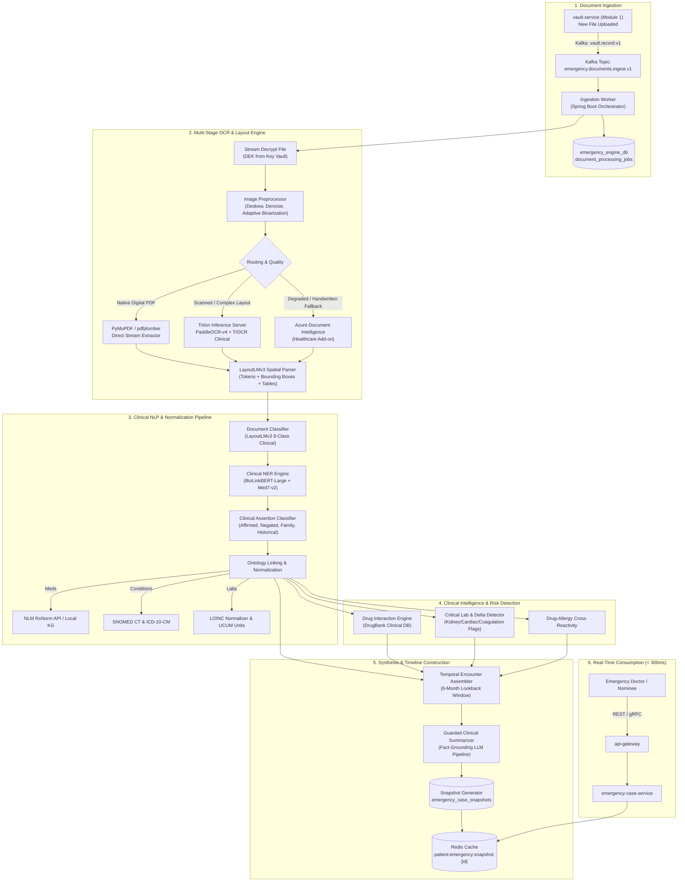
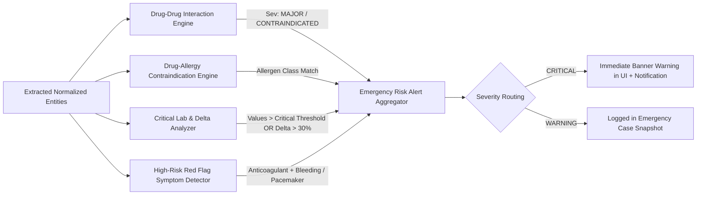

# MediVault AI — Module 2: Emergency Case File Engine

> Production Architecture Specification · v2.0 · Healthcare AI Architecture  
> Target: Instant emergency clinical summary from patient health records (6-month dynamic lookback)  
> Stack: Python 3.11 / FastAPI (AI processing workers) · Spring Boot 3.x (Orchestrator) · PyTorch · Triton Inference Server · PostgreSQL 16 · Redis · Kafka (Event Hubs) · Azure Blob Storage

---

## 1. Executive Summary & Objective

In emergency departments, trauma centers, and acute triage, medical teams operate under extreme time pressure with zero prior knowledge of an incoming patient. Accessing fragmented historical records across multiple hospitals, disparate PDFs, handwritten prescriptions, and diagnostic printouts takes upwards of 25–40 minutes—time critical patients do not have.

The **Emergency Case File Engine** ingests, parses, classifies, standardizes, and synthesizes all health records uploaded to MediVault into an **instant, high-fidelity Emergency Snapshot (< 300 ms retrieval)** covering:
1. **Allergy Alerts** (severity, drug class cross-reactivity, source report verification)
2. **Emergency Warnings & Contraindications** (active anticoagulants, severe organ impairment, critical lab deltas, black-box warnings)
3. **Current Active Medications** (RxNorm reconciled, dosage, frequency, prescribing encounter)
4. **Critical Medical History** (ICD-10 / SNOMED CT coded active diagnoses, surgical implants, pacemakers, stents)
5. **Longitudinal Lab Trends** (LOINC normalized: hemoglobin, platelets, creatinine, eGFR, troponin, INR, potassium, glucose)
6. **Physician Emergency Brief** (guarded abstractive-extractive clinical summary strictly grounded with cryptographic provenance to eliminate LLM hallucinations)
7. **Interactive 6-Month Timeline View** (temporal ordering of all clinical encounters, hospitalizations, and diagnostic reports)

---

## 2. End-to-End Processing Architecture



---

## 3. High-Precision OCR & Spatial Layout Pipeline

Medical documents vary from pristine digital vector PDFs (e.g., Quest Diagnostics) to multi-generation thermal faxes, low-resolution camera uploads, and handwritten prescription notes. A single generic OCR model fails in healthcare scenarios. MediVault AI employs an intelligent **Cascading 3-Tier OCR Engine**.

### 3.1 Preprocessing & Image Normalization
Before OCR tokenization, images undergo computer vision normalization via OpenCV and Albumentations:
1. **DPI Resampling:** Force 300 DPI baseline.
2. **Deskewing:** Radon transform / Hough line transform for automatic angle rotation correction (-45° to +45°).
3. **Adaptive Binarization:** Sauvola thresholding to eliminate shadows and background paper discoloration without eroding fine handwritten characters.
4. **Illumination Correction:** Contrast Limited Adaptive Histogram Equalization (CLAHE) applied to prescription margins.

### 3.2 Cascading OCR Routing Matrix

| Document Category | Primary Engine | Secondary Fallback | Latency Target | Accuracy Target (Character Error Rate) |
|---|---|---|---|---|
| **Digital Vector PDF** | PyMuPDF / PDFMiner text extraction | PyTesseract | < 80 ms / page | CER < 0.005 (99.5%) |
| **Printed Lab Reports & Discharge Summaries** | PaddleOCR-v4 (PP-OCRv4 Server) on Triton GPU | LayoutLMv3 | < 250 ms / page | CER < 0.02 (98%) |
| **Handwritten Prescription / Doctor Note** | TrOCR Large Stage 2 Fine-Tuned on IAM & Clinical EHR notes | Azure Document Intelligence Healthcare OCR | < 600 ms / page | CER < 0.06 (94%) |

### 3.3 Spatial Coordinate Anchor & Provenance
Every extracted text token retains its geometric coordinate:
$$\text{Token} = \{ \text{text}: \text{"Metformin"}, \, \text{confidence}: 0.994, \, \text{bbox}: [x_0, y_0, x_1, y_1], \, \text{page}: 1, \, \text{line\_id}: 14 \}$$
This bounding box is propagated through NER and LLM summarization. When an emergency physician clicks on any medication or lab result in the UI, the interface instantly highlights the exact spatial bounding box on the original source document PDF, establishing immediate clinical trust.

---

## 4. Clinical NLP, Entity Extraction & Ontology Linking

### 4.1 Document Classification (LayoutLMv3)
Documents are categorized into one of 8 classes using a multi-modal transformer (**LayoutLMv3**) combining 2D spatial layout coordinates, image patches, and extracted text tokens:
1. `LAB_REPORT`
2. `PRESCRIPTION`
3. `CLINICAL_NOTE`
4. `DISCHARGE_SUMMARY`
5. `IMAGING_REPORT`
6. `PATHOLOGY`
7. `IMMUNIZATION`
8. `OTHER`

### 4.2 Clinical Named Entity Recognition (NER)
A biomedical transformer fine-tuned on clinical notes (**BioLinkBERT-Large** + specialized **Med7-v2** heads) extracts 7 distinct clinical entity categories:

```
[DOCUMENT EXCERPT]
"Patient with acute STEMI in Jan 2026. Prescribed Brilinta 90mg BID, Metoprolol Tartrate 25mg PO daily.
Known anaphylactic allergy to Penicillin. eGFR declined from 68 to 38 mL/min/1.73m2."

EXTRACTED ENTITIES:
- Condition: "STEMI" (ST-Elevation Myocardial Infarction) -> SNOMED: 401303003
- Medication: "Brilinta", Dose: "90mg", Frequency: "BID" -> RxNorm: 1116632 (Ticagrelor 90 MG)
- Medication: "Metoprolol Tartrate", Dose: "25mg", Route: "PO", Frequency: "daily" -> RxNorm: 866418
- Allergy: "Penicillin", Severity: "Anaphylactic" -> SNOMED: 294532003
- Lab Observation: "eGFR", Value: 38, Baseline: 68, Flag: CRITICAL_DROP -> LOINC: 33914-3
```

### 4.3 Assertion Status & Negation Detection
Extracted entities without context can be clinically hazardous (e.g., extracting "Patient denies chest pain" as an active condition of "Chest Pain").
Each entity passes through an **Assertion Classifier** producing one of four mutually exclusive statuses:
- `AFFIRMED` (e.g., "Patient diagnosed with Type 2 Diabetes") $\rightarrow$ ingested into active profile.
- `NEGATED` (e.g., "No history of stroke or TIA") $\rightarrow$ tagged as verified negative; excluded from active alerts.
- `FAMILY_HISTORY` (e.g., "Father had sudden cardiac arrest at age 45") $\rightarrow$ routed to hereditary risk index.
- `POSSIBLE / SUSPECTED` (e.g., "Rule out pulmonary embolism") $\rightarrow$ flagged with an exploratory diagnostic tag.

### 4.4 Ontology Normalization Table

| Clinical Dimension | Target Code System | Enrichment Pipeline | Validation Rules |
|---|---|---|---|
| **Medications** | **RxNorm** (Concept Unique Identifier - RxCUI) | NLM RxNav REST API + Local Trie Cached Lexicon | Must resolve to Clinical Drug or Ingredient level |
| **Diagnoses & Conditions** | **SNOMED CT** + **ICD-10-CM** | BioPortal API / QuickUMLS semantic linkage | Direct cross-walk between billing ICD-10 and clinical SNOMED |
| **Laboratory Tests** | **LOINC** + **UCUM Units** | Regenstrief LOINC database fuzzy matching + unit normalizer | Normalizes variations (e.g. "HbA1c", "Glycated Hemoglobin", "Hemoglobin A1c" $\rightarrow$ `4548-4`) |
| **Allergies & Reactions** | **SNOMED CT** (Allergen + Reaction Manifestation) | MedDRA / SNOMED hierarchy | Class-level mapping (e.g., Amoxicillin maps to Beta-lactam antibacterial class) |

---

## 5. Clinical Risk Detection & Emergency Rules Engine

The Risk Detection Engine runs synchronously upon document ingestion and continuously against the 6-month longitudinal record.



### 5.1 Critical Lab Delta & Threshold Monitoring
The engine tracks high-volatility emergency parameters across the 6-month lookback:

| Test Name | LOINC Code | Critical Low Threshold | Critical High Threshold | Critical Delta Alert Condition |
|---|---|---|---|---|
| **Potassium ($K^+$)** | `2823-3` | $< 2.8 \text{ mmol/L}$ | $> 6.0 \text{ mmol/L}$ | $> 1.5 \text{ mmol/L}$ change within 48 hours |
| **Platelets** | `777-3` | $< 50 \times 10^9/\text{L}$ | $> 1000 \times 10^9/\text{L}$ | Sudden 50% drop from baseline |
| **Troponin I / T** | `42757-5` | N/A | $> \text{99th percentile URL}$ | Any elevation above reference URL |
| **eGFR (Creatinine)** | `33914-3` | $< 15 \text{ mL/min}$ (ESRD) | N/A | $\ge 30\%$ decrease in last 30 days (Acute Kidney Injury) |
| **INR (Warfarin)** | `6301-6` | $< 1.5$ (if anticoagulated) | $> 4.5$ (Severe bleeding risk) | $> 1.0$ change between tests |
| **Hemoglobin** | `718-7` | $< 7.0 \text{ g/dL}$ | $> 20.0 \text{ g/dL}$ | Drop $\ge 2.0 \text{ g/dL}$ within 7 days |

---

## 6. Guarded Medical Summarization with Provenance

Generative LLMs used in healthcare pose severe risks if allowed to hallucinate medications, dosages, or diagnoses. MediVault AI enforces a **Two-Tier Constrained Summarization Architecture**:

```mermaid
sequenceDiagram
  autonumber
  participant REQ as Case File Builder
  participant FACT as Fact Extractor (Structured Entities)
  participant LLM as Clinical LLM (Llama 3.3 Med-Prompt)
  participant VERIFIER as NLI Hallucination Verifier
  participant CACHE as Snapshot Store

  REQ->>FACT: Fetch 6-Month Structured Entities (RxNorm, SNOMED, LOINC)
  FACT-->>REQ: Canonical JSON Context Matrix
  REQ->>LLM: Generate Physician Summary (Strict Context Constraint Prompt)
  LLM-->>VERIFIER: Draft Summary Sentences + Attribution Citations
  VERIFIER->>VERIFIER: Natural Language Inference (Entailment Check against Sources)
  alt Entailment Score >= 0.95
    VERIFIER-->>CACHE: Accept Summary + Attach Provenance Hashes
  else Entailment Score < 0.95 (Hallucination Detected)
    VERIFIER-->>CACHE: Reject Draft; Fallback to Deterministic Template Summary
  end
```

### Prompt Guard Template

```markdown
[SYSTEM]
You are an expert emergency medical summarizer. 
Summarize the patient's critical health status for an incoming Emergency Physician based ONLY on the provided structured JSON data from the last 6 months.

STRICT CLINICAL SAFETY RULES:
1. State ONLY facts present in the source data. DO NOT extrapolate, infer, or speculate.
2. Highlight immediate life-threatening conditions first: anaphylactic allergies, active anticoagulants, unstable vitals/labs, cardiac devices.
3. Every sentence MUST be appended with its source entity ID tag: [E-XXXX].
4. If a drug dosage or frequency is ambiguous, state "dosage unspecified [E-XXXX]".
5. Maximum length: 180 words. Bulleted, structured, high-density format.
```

---

## 7. API Specifications

Base URL: `/api/v1/emergency-engine` (Internal microservice routed via API Gateway)

### 7.1 Trigger Document Processing Job

```http
POST /api/v1/emergency-engine/jobs
Content-Type: application/json
Authorization: Bearer <service_jwt>

{
  "storedFileId": "0192f1a3-7b1e-7c55-9a0e-3c1f2d4e5a6b",
  "patientId": "0191e4b8-2a1c-7d33-8f0a-1e2d3c4b5a6f",
  "documentTypeHint": "LAB_REPORT"
}
```

**Response (202 Accepted):**
```json
{
  "jobId": "0192f2b1-8c3d-7e44-9b1f-2a3b4c5d6e7f",
  "status": "QUEUED",
  "estimatedDurationMs": 2400,
  "createdAt": "2026-10-24T17:10:00Z"
}
```

---

### 7.2 Get Instant Emergency Case Snapshot (< 300 ms)

```http
GET /api/v1/emergency-engine/patients/{patientId}/snapshot
Authorization: Bearer <jwt_with_emergency_card_read>
If-None-Match: "0192f2cc-prov-hash-99a"
```

**Response (200 OK):**
```json
{
  "patientId": "0191e4b8-2a1c-7d33-8f0a-1e2d3c4b5a6f",
  "snapshotVersion": 4,
  "timeWindow": {
    "start": "2026-04-24T17:12:00Z",
    "end": "2026-10-24T17:12:00Z"
  },
  "bloodGroup": "O+",
  "emergencyWarnings": [
    {
      "level": "CRITICAL",
      "category": "BLACK_BOX_WARNING",
      "title": "Active Oral Anticoagulant (Apixaban)",
      "description": "Patient is actively taking Eliquis 5mg BID for Non-Valvular Atrial Fibrillation. High risk of major hemorrhage during trauma or acute surgery. Antidote: Andexanet Alfa.",
      "provenance": { "entityId": "0192f233-a1b2", "sourceFileId": "0192f1a3-7b1e" }
    },
    {
      "level": "CRITICAL",
      "category": "CRITICAL_LAB_DELTA",
      "title": "Acute Kidney Injury (eGFR Precipitous Drop)",
      "description": "eGFR decreased by 44% from 68 mL/min (Jul 2026) to 38 mL/min (Oct 18, 2026). Adjust renally cleared medications.",
      "provenance": { "entityId": "0192f244-c3d4", "sourceFileId": "0192f1b4-8c2f" }
    }
  ],
  "allergyAlerts": [
    {
      "allergen": "Penicillin V",
      "snomedCode": "294532003",
      "severity": "ANAPHYLAXIS",
      "crossReactivityClass": "Beta-Lactam Antibiotics",
      "lastEncounterNoted": "2026-08-14"
    }
  ],
  "activeMedications": [
    {
      "name": "Eliquis (Apixaban) 5 MG Oral Tablet",
      "rxnormCui": "1364441",
      "dose": "5 mg",
      "frequency": "BID (Twice Daily)",
      "prescribedDate": "2026-09-10",
      "status": "ACTIVE"
    },
    {
      "name": "Metoprolol Succinate 50 MG Extended Release Oral Tablet",
      "rxnormCui": "866514",
      "dose": "50 mg",
      "frequency": "Daily",
      "prescribedDate": "2026-09-10",
      "status": "ACTIVE"
    }
  ],
  "criticalHistory": [
    {
      "condition": "Atrial Fibrillation",
      "icd10": "I48.0",
      "snomed": "49436004",
      "firstDocumented": "2026-05-12"
    },
    {
      "condition": "Dual-Chamber Permanent Cardiac Pacemaker (Medtronic Azure)",
      "snomed": "441509002",
      "implantDate": "2026-06-01",
      "mriSafety": "MRI Conditional"
    }
  ],
  "labTrends": [
    {
      "testName": "Creatinine [Mass/volume] in Serum or Plasma",
      "loinc": "2160-0",
      "unit": "mg/dL",
      "history": [
        { "date": "2026-05-10", "value": 1.1, "flag": "NORMAL" },
        { "date": "2026-07-22", "value": 1.3, "flag": "NORMAL" },
        { "date": "2026-10-18", "value": 2.1, "flag": "HIGH" }
      ]
    },
    {
      "testName": "Hemoglobin [Mass/volume] in Blood",
      "loinc": "718-7",
      "unit": "g/dL",
      "history": [
        { "date": "2026-05-10", "value": 14.2, "flag": "NORMAL" },
        { "date": "2026-10-18", "value": 13.8, "flag": "NORMAL" }
      ]
    }
  ],
  "physicianSummary": "68-year-old patient with active Atrial Fibrillation and permanent cardiac pacemaker [E-01]. Currently taking Eliquis 5mg BID (high bleeding risk; reversal: Andexanet Alfa) [E-02]. Demonstrates acute kidney function decline (eGFR drop to 38 mL/min, Creatinine 2.1 mg/dL on Oct 18) [E-03]. Anaphylactic allergy to Penicillins [E-04].",
  "generatedAt": "2026-10-24T17:12:30Z",
  "provenanceHash": "sha256:d41d8cd98f00b204e9800998ecf8427e"
}
```

---

## 8. Indexing, Materialization & Performance Strategy

To guarantee the **< 300 ms response time** required in emergency rooms:

1. **Pre-Materialized Snapshot Generation:** Snapshots are NEVER computed on-demand when the doctor clicks the emergency link. They are computed asynchronously when any new document finishes ingestion and stored in Redis as a pre-warmed JSON blob (`patient:emergency:snapshot:{patientId}`).
2. **Invalidation Policy:** Ingestion of a new document marks `is_current = false` in `emergency_case_snapshots`, executes delta-reconciliation, writes a new snapshot row, and atomically updates the Redis cache key via `SET ... EX 21600` (6-hour TTL).
3. **Compound PostgreSQL Indexing:**
   - Spatial indexing: `btree_gist` indices for overlapping temporal ranges.
   - Trigram indexing (`pg_trgm`): rapid fuzzy search on medication and condition names for physician search within the emergency view.

---

## 9. Production Rollout & Implementation Plan

| Phase | Duration | Scope | Validation Gate |
|---|---|---|---|
| **Phase 1: Ingestion & Multi-OCR** | Weeks 1–3 | Preprocessing CV pipeline, Triton PaddleOCR + TrOCR deployment, LayoutLMv3 spatial parser | OCR Character Error Rate < 2% on test set of 500 scanned hospital records |
| **Phase 2: Clinical NER & Normalization** | Weeks 4–6 | BioLinkBERT NER fine-tuning, RxNorm / SNOMED / LOINC local semantic linkers, assertion negation | NER F1 Score > 0.92; RxNorm entity linking precision > 0.96 |
| **Phase 3: Risk Engine & Lab Trends** | Weeks 7–8 | Drug-drug interaction engine (DrugBank), critical delta tracking, contraindication rule engine | 100% detection of synthetic lethal DDI pairs; zero missed anaphylaxis alerts |
| **Phase 4: Guarded Summarization** | Weeks 9–10 | Prompt template guardrails, NLI entailment verifier, provenance bounding-box click-through | Hallucination rate = 0.00% on 200 clinical evaluation audits |
| **Phase 5: High-Load Stress & DR** | Weeks 11–12 | Redis caching, end-to-end latency tuning, failover drills, edge-case handling | Snapshot retrieval latency p99 < 280 ms at 1,000 concurrent RPS |
