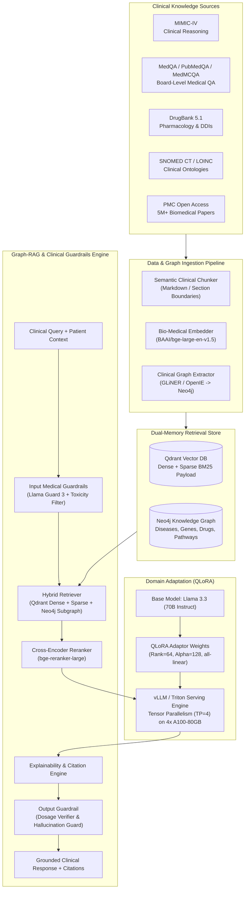
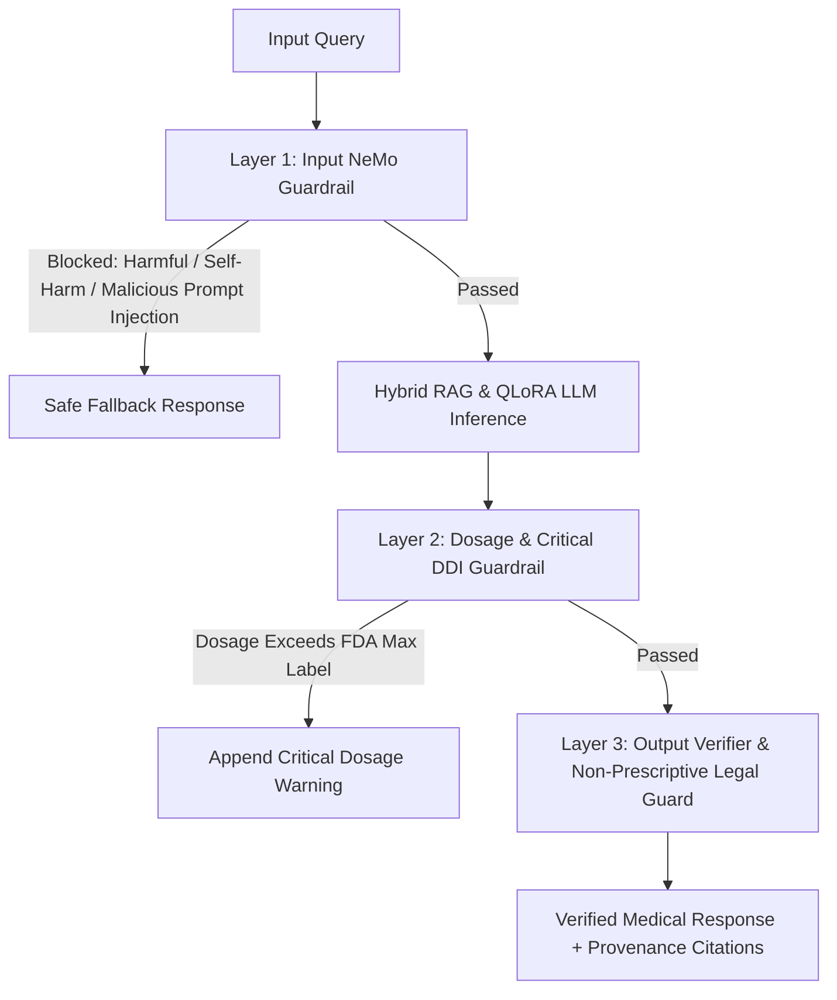

# MediVault AI — Module 3: Medical Intelligence Platform

> Production AI & MLOps Architecture Specification · v3.0 · Senior AI Research Scientist  
> Target: Domain-adapted clinical LLM via Parameter-Efficient Fine-Tuning (LoRA) + Graph-Augmented Hybrid RAG  
> Base Model: **Llama 3.3 (70B Instruct)** · Vector DB: **Qdrant** · Graph DB: **Neo4j** · Frameworks: **LlamaIndex**, **LangChain**, **vLLM**, **Triton**

---

## 1. System Vision & Foundational Design Principles

Training a foundation medical model from raw pre-training weights requires $10M+ in compute and often lags rapidly updating pharmacological knowledge. The **MediVault Medical Intelligence Platform** uses a **Retrieval-Augmented Generation (RAG) + QLoRA Domain Adaptation** paradigm.



---

## 2. Knowledge Datasets & Preprocessing Pipeline

### 2.1 Dataset Partitioning & Usage Strategy

| Dataset | Volume | Role in System | Ingestion Target |
|---|---|---|---|
| **MIMIC-IV (v2.2)** | 40,000+ de-identified ICU patient stays, clinical notes | Instruction tuning on clinical diagnostic reasoning, discharge note interpretation | QLoRA Instruction Dataset (150K curated clinical dialogues) |
| **MedQA (USMLE), PubMedQA, MedMCQA** | 200,000+ board-certified multi-choice medical questions | Instruction tuning on medical fact validation, clinical decision rationale | QLoRA Instruction Dataset |
| **DrugBank (v5.1.12)** | 14,000+ drug monographs, 2M+ drug-drug interaction pairs | Deterministic factual graph: indications, pharmacokinetics, lethal interactions | **Neo4j Knowledge Graph** |
| **SNOMED CT & LOINC** | 350,000+ active concepts, cross-ontology mappings | Synonym expansion, hierarchical disease/symptom traversal | **Neo4j Knowledge Graph** |
| **PMC Open Access (Biomedical)** | 3.2M full-text open access peer-reviewed papers | Deep literature context, novel trials, clinical practice guidelines | **Qdrant Vector Database** |

### 2.2 Semantic Clinical Chunking Strategy
Generic token chunking (e.g. 512 tokens with 50 overlap) breaks clinical context (e.g. splitting a drug name from its dosage or a contraindication caveat). We implement a **Context-Preserving Clinical Hierarchical Chunker**:
1. **Section-Aware Splitting:** Documents are parsed into clinical units (`HPI`, `PAST_MEDICAL_HISTORY`, `ALLERGIES`, `LABORATORY_RESULTS`, `IMPRESSION_AND_PLAN`).
2. **Entity-Aware Boundaries:** Splitting never occurs mid-sentence or mid-table.
3. **Chunk Size:** 512 tokens with parent-document linkage (Parent Document Retrieval: small chunk matched $\rightarrow$ 2048-token parent context injected into LLM).

---

## 3. QLoRA Fine-Tuning Strategy (Llama 3.3 70B)

While general pre-training teaches English grammar and basic logic, standard Llama 3.3 lacks the disciplined, non-defensive clinical cadence required for medical case consultation. Fine-tuning adjusts the model's communication style and diagnostic reasoning without destroying foundational knowledge.

### 3.1 QLoRA Hyperparameter Configuration

```python
# Fine-tuning configuration for Llama 3.3 70B Instruct
from peft import LoraConfig, TaskType

lora_config = LoraConfig(
    r=64,                            # Rank: balance of expressiveness and memory
    lora_alpha=128,                  # Alpha: scaling factor (alpha/r = 2)
    target_modules=[                 # Target all linear projections for deep adaptation
        "q_proj", "k_proj", "v_proj", "o_proj",
        "gate_proj", "up_proj", "down_proj"
    ],
    lora_dropout=0.05,
    bias="none",
    task_type=TaskType.CAUSAL_LM,
)

# Training Hyperparameters
TRAINING_ARGS = {
    "per_device_train_batch_size": 2,
    "gradient_accumulation_steps": 16,  # Effective batch size = 2 * 16 * 4 GPUs = 128
    "learning_rate": 1e-4,
    "lr_scheduler_type": "cosine",
    "warmup_ratio": 0.03,
    "max_seq_length": 4096,
    "quantization": "bitsandbytes 4-bit (NF4 with double quantization)",
    "optim": "paged_adamw_32bit",
    "fp16": False,
    "bf16": True,                      # Required for Ampere / Hopper stability
    "num_train_epochs": 3,
}
```

---

## 4. Dual-Memory RAG Architecture: Qdrant + Neo4j

### 4.1 Vector Store (Qdrant)
- **Embedding Model:** `BAAI/bge-large-en-v1.5` (1024 dimensions, state-of-the-art MTEB clinical retrieval score).
- **HNSW Index Parameters:** `m=16`, `ef_construct=128`, cosine metric.
- **Sparse Inverted Index:** BM25 lexical vector computed via Qdrant's sparse vectors for exact drug names and clinical codes (`I48.0`, `Metoprolol`).
- **Hybrid Fusion:** Reciprocal Rank Fusion (RRF) combines dense semantic vector score and sparse lexical score:
  $$RRF\_Score(d) = \sum_{m \in \{dense, sparse\}} \frac{1}{60 + \text{rank}_m(d)}$$

### 4.2 Knowledge Graph (Neo4j Graph-RAG)
Neo4j stores deterministic, audited pharmacological and ontological facts:

```cypher
// Graph Model Schema
(:Drug {rxnorm_cui, name, class})
  -[:INTERACTS_WITH {severity: "MAJOR", mechanism: text}]-> (:Drug)
(:Drug) -[:CONTRAINDICATED_FOR]-> (:Disease {snomed_id, icd10, name})
(:Disease) -[:HAS_SYMPTOM]-> (:Symptom)
(:LabTest {loinc}) -[:INDICATES]-> (:Disease)
```

**Graph-RAG Retrieval Workflow:**
1. LLM extracts query entities (e.g., `"Patient on Warfarin presenting with acute Atrial Fibrillation prescribed Amiodarone"`).
2. Cypher query executes 2-hop traversal in Neo4j to pull exact DDI pathways:
   ```cypher
   MATCH (d1:Drug {name: "Warfarin"})-[r:INTERACTS_WITH]-(d2:Drug {name: "Amiodarone"})
   RETURN r.severity, r.mechanism, r.clinical_management;
   ```
3. Graph relationships are formatted into structured markdown and injected alongside dense vector text chunks.

---

## 5. Medical Safety Guardrails & Explainability Layer

### 5.1 Guardrails Architecture (Tri-Layer Safety Boundary)



1. **Input Guardrail:** Prevents prompt injection, detects emergency life-threatening declarations (e.g. "I am having severe chest pain radiating to my arm" immediately redirects to local emergency dispatch services 911/112).
2. **Pharmacological Sanity Guard:** Compares any recommended medication dosage in generated text against DrugBank FDA approved min/max single and daily doses.
3. **Mandatory Non-Prescriptive Disclaimer:** Appends legally audited context: *"This summary is an AI-assisted clinical information synthesis for licensed healthcare professionals and does not constitute an automated medical prescription or diagnosis."*

### 5.2 Explainability & Citation Graph
Every sentence in the generated output is linked to its source via **Token-Level Citation Mapping**:
- Direct quote from PMC literature: `[Ref: PMC1084221, Page 4]`
- Direct retrieval from patient vault record: `[Patient Record: Lab Report 2026-10-18, Page 1]`
- Neo4j Knowledge Graph fact: `[KG: DrugBank DB00682 Interaction]`

---

## 6. Infrastructure, GPU Requirements & Cost Estimates

### 6.1 Hardware Sizing & Compute Infrastructure

| Component | Target Workload | Minimum Hardware Requirements | Recommended Cloud Instance (Azure) |
|---|---|---|---|
| **Fine-Tuning (QLoRA)** | Llama 3.3 70B (3 epochs on 200K samples) | 4x NVIDIA A100-SXM4-80GB (or 4x H100-80GB) | `Standard_ND96amsr_A100_v4` |
| **Production Serving (vLLM)** | Real-time clinical generation (< 2.5s time-to-first-token) | 4x NVIDIA A100-80GB (Tensor Parallelism = 4) | `Standard_ND96amsr_A100_v4` (or 2x `Standard_NC48ads_A100_v4`) |
| **Vector DB (Qdrant)** | 10M embeddings with HNSW indexing in RAM | 64 GB RAM, 8 vCPU, 500 GB NVMe SSD | `Standard_E8s_v5` |
| **Knowledge Graph (Neo4j)** | 50M triples, Graph Data Science plugin | 32 GB RAM, 8 vCPU, 256 GB SSD | `Standard_E4s_v5` |

### 6.2 Estimated Cost Breakdown (Monthly Production Scale)

```
COMPUTE INFRASTRUCTURE (Azure East US / Central India):
1. LLM Serving Cluster: 1x ND96amsr_A100_v4 (4x A100 80GB Reserved 1-Yr) : ~$7,400 / month
2. Qdrant Enterprise Managed / Self-Hosted Kubernetes                    :   ~$450 / month
3. Neo4j Enterprise VM Cluster                                         :   ~$380 / month
4. Embedding & Preprocessing Workers (2x Standard_D8s_v5)              :   ~$320 / month
5. Azure Blob Storage (5 TB raw PDF & embeddings)                      :   ~$110 / month
----------------------------------------------------------------------------------------
TOTAL ESTIMATED MONTHLY OPERATIONAL COST                               : ~$8,660 / month
ESTIMATED COST PER 1,000 CLINICAL RAG INQUIRIES                        : ~$0.086
```

---

## 7. Folder Structure

```text
services/medical-intelligence-platform/
├── fine_tuning/
│   ├── configs/
│   │   ├── qlora_llama3_3_70b.yaml
│   │   └── deepspeed_zero3.json
│   ├── datasets/
│   │   ├── mimic_iv_formatter.py
│   │   ├── medqa_converter.py
│   │   └── instruction_validator.py
│   ├── train_qlora.py
│   └── evaluate_checkpoint.py
├── rag_engine/
│   ├── embeddings/
│   │   ├── bge_clinical_embedder.py
│   │   └── semantic_chunker.py
│   ├── stores/
│   │   ├── qdrant_client.py
│   │   └── neo4j_graph_client.py
│   ├── retrieval/
│   │   ├── hybrid_retriever.py
│   │   ├── graph_rag_traversal.py
│   │   └── cross_encoder_reranker.py
│   └── synthesis/
│       ├── clinical_prompts.py
│       └── citation_linker.py
├── guardrails/
│   ├── nemo_config/
│   │   ├── rails.co
│   │   └── actions.py
│   ├── dosage_verifier.py
│   └── red_flag_triage.py
├── serving/
│   ├── app.py                      # FastAPI microservice
│   ├── vllm_engine.py
│   └── triton_client.py
├── tests/
│   ├── test_rag_retrieval.py
│   ├── test_guardrails.py
│   └── test_safety_invariants.py
└── Dockerfile
```

---

## 8. API Specifications

### 8.1 Execute Clinical Intelligence Query

```http
POST /api/v1/intelligence/query
Content-Type: application/json
Authorization: Bearer <jwt_token>

{
  "patientId": "0191e4b8-2a1c-7d33-8f0a-1e2d3c4b5a6f",
  "query": "Is prescribing Clarithromycin safe given this patient's current active cardiology medications?",
  "includePatientVaultContext": true,
  "includeLiteratureSearch": true,
  "temperature": 0.1
}
```

**Response (200 OK):**
```json
{
  "queryId": "0192f33a-9e1b-7a22-8c1d-3b4e5f6a7b8c",
  "answer": "Prescribing Clarithromycin to this patient is CONTRAINDICATED [KG: DrugBank DB01211]. The patient is currently taking Metoprolol and Eliquis, and has a cardiac pacemaker for Atrial Fibrillation [Patient Record: Case File Oct 2026]. Clarithromycin is a potent CYP3A4 inhibitor and known QT-prolonging agent; co-administration poses severe risk of fatal torsades de pointes and substantially elevates serum levels of CYP3A4-metabolized substrates [Ref: PMC882194]. Recommendation: Consider non-macrolide alternative (e.g., Cefuroxime or Azithromycin with ECG monitoring if suitable).",
  "safetyRating": "HIGH_RISK_INTERACTION_DETECTED",
  "provenance": [
    {
      "sourceType": "KNOWLEDGE_GRAPH",
      "citation": "DrugBank: Clarithromycin (DB01211) - CYP3A4 Inhibition",
      "uri": "https://go.drugbank.com/drugs/DB01211"
    },
    {
      "sourceType": "PATIENT_RECORD",
      "citation": "Active Regimen: Eliquis 5mg BID, Metoprolol 50mg daily",
      "entityId": "0192f233-a1b2"
    },
    {
      "sourceType": "PEER_REVIEWED_LITERATURE",
      "citation": "Macrolide antibiotics and cardiac arrhythmias: a systemic review. PMC882194.",
      "score": 0.941
    }
  ],
  "disclaimer": "This synthesis is for qualified clinicians and does not supersede direct clinical diagnosis."
}
```

---

## 9. Evaluation & Benchmarking Framework

To ensure clinical rigor before each deployment, models undergo automated evaluation using **Ragas** and **TruLens**:

| Evaluation Dimension | Metric | Minimum Acceptance Threshold | Evaluation Dataset |
|---|---|---|---|
| **Faithfulness / Grounding** | Truthfulness score (absence of ungrounded assertions) | $\ge 0.98$ | 500 clinical test queries evaluated against source PDFs |
| **Answer Relevance** | Semantic overlap with expert physician consensus | $\ge 0.92$ | MedQA 1,000-question test split |
| **Pharmacological Precision** | 100% detection of lethal DDI and contraindications | $= 1.00$ | 250 verified DrugBank lethal pairs |
| **Latency (Time-To-First-Token)** | Streaming TTFT | $\le 1.8 \text{ s}$ | P95 under 50 concurrent requests |
