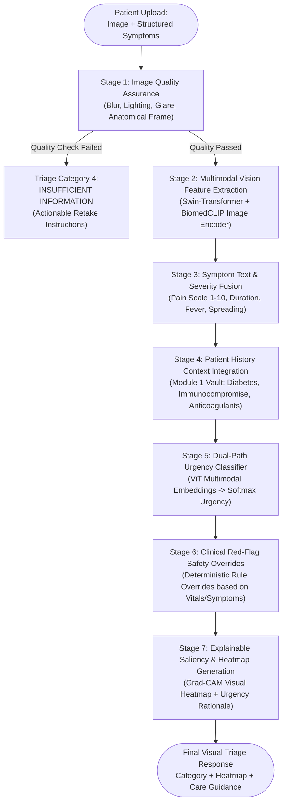
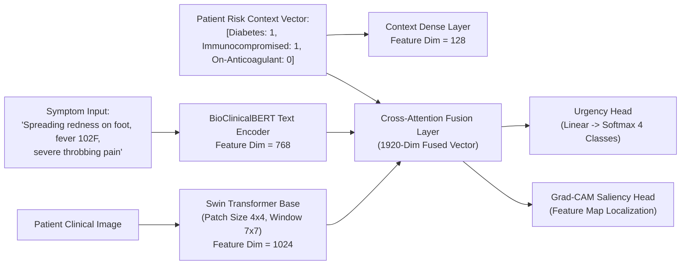

# MediVault AI — Module 4: AI Visual Triage

> Production Architecture Specification · v4.0 · Medical AI Vision Architect  
> Objective: Safety-guided clinical urgency classification from photographic images and patient-reported symptoms  
> Regulatory Guardrail: **Urgency Guidance Only — Never Directly Diagnoses Diseases** (FDA SaMD Class II & EU MDR Non-Diagnostic Compliance)  
> Stack: PyTorch · Swin Transformer / BiomedCLIP · Triton Inference Server · FastAPI · Grad-CAM Explainability · Azure Blob Storage

---

## 1. Clinical Goal & Regulatory Boundary

Patients frequently capture photographs of acute clinical presentations: dermatological rashes, burns, trauma wounds, ocular redness, post-operative surgical site infections, or pediatric swellings. Layperson anxiety leads to either inappropriate emergency department crowding or dangerous delays in seeking critical emergency care.

The **AI Visual Triage Platform** delivers an **objective urgency assessment** to guide the patient to the appropriate level of care within seconds, while strictly observing the fundamental clinical safety directive:

> ⚠️ **CRITICAL REGULATORY INVARIANT (FDA SaMD & SaMD Rule 2024):**  
> The system **NEVER** issues a diagnostic label (e.g. *"You have Melanoma"* or *"You have Cellulitis"*).  
> Instead, it assesses **visual and symptomatic severity indicators** to classify urgency into four validated triage categories with recommended actions and timeframes.

### The 4 Urgency Categories

```
┌─────────────────────────────────────────────────────────────────────────────┐
│ 1. EMERGENCY CARE NOW                                                       │
│    Timeframe: Immediate (Call 911 / 112 / Present to nearest Emergency Room) │
│    Examples: Open compound fractures, third-degree circumferential burns,   │
│              anaphylactic facial/airway edema, petechial/purpuric rashes    │
│              with fever (suspected meningococcemia), acute eye trauma.      │
├─────────────────────────────────────────────────────────────────────────────┤
│ 2. PROMPT ASSESSMENT                                                        │
│    Timeframe: Within 12–24 Hours (Urgent Care Clinic / Same-Day Appointment)│
│    Examples: Spreading localized erythema (possible cellulitis without      │
│              systemic sepsis), deep lacerations requiring sutures, partial  │
│              thickness scald burns < 5% BSA, corneal foreign body sensation.│
├─────────────────────────────────────────────────────────────────────────────┤
│ 3. ROUTINE CONSULTATION                                                     │
│    Timeframe: Within 1–2 Weeks (Primary Care / Outpatient Specialist)       │
│    Examples: Chronic localized eczema, stable acne vulgaris, minor closed   │
│              bruising without joint compromise, mild seborrheic dermatitis. │
├─────────────────────────────────────────────────────────────────────────────┤
│ 4. INSUFFICIENT INFORMATION                                                 │
│    Action: Mandatory Image Re-Take or Direct Triage Nurse Consultation      │
│    Trigger: Image blurry (Laplacian variance < 100), underexposed,          │
│              overexposed, glare on wound, anatomical site obstructed.       │
└─────────────────────────────────────────────────────────────────────────────┘
```

---

## 2. Seven-Stage Pipeline Architecture



---

## 3. Image Quality Assurance (Stage 1)

Poor image quality in telemedicine is the primary driver of catastrophic mis-triage. An automated Quality Assurance gate rejects suboptimal photos before classification:

```python
# Production Image Quality Gate
import cv2
import numpy as np

def evaluate_image_quality(image_bytes: bytes) -> dict:
    nparr = np.frombuffer(image_bytes, np.uint8)
    img = cv2.imdecode(nparr, cv2.IMREAD_COLOR)
    
    # 1. Resolution Check
    height, width = img.shape[:2]
    if height < 600 or width < 600:
        return {"passed": False, "reason": "RESOLUTION_TOO_LOW", "guidance": "Please upload a photo with at least 600x600 resolution."}
    
    # 2. Blur Detection (Modified Laplacian Variance)
    gray = cv2.cvtColor(img, cv2.COLOR_BGR2GRAY)
    laplacian_var = cv2.Laplacian(gray, cv2.CV_64F).var()
    if laplacian_var < 110.0:
        return {"passed": False, "reason": "IMAGE_BLURRY", "guidance": "The camera was out of focus. Hold the phone steady 10-15 cm from the area."}
        
    # 3. Illumination / Exposure Check
    mean_brightness = np.mean(gray)
    if mean_brightness < 45.0:
        return {"passed": False, "reason": "UNDEREXPOSED", "guidance": "The room is too dark. Turn on a room light or enable phone flash."}
    if mean_brightness > 220.0:
        return {"passed": False, "reason": "OVEREXPOSED_GLARE", "guidance": "Direct flash reflection or glare detected. Angle the camera slightly to avoid reflection."}
        
    return {"passed": True, "laplacian": laplacian_var, "brightness": mean_brightness}
```

---

## 4. Vision-Language Model Design (BiomedCLIP + Swin-B)

The classification backbone combines vision features and patient-reported symptoms into a joint embedding space.



### Multimodal Fusion Mechanism
- **Vision Backbone:** Swin Transformer Base pre-trained on ImageNet-22k and fine-tuned on Fitzpatrick17k, ISIC, and clinical emergency dermatological databases.
- **Cross-Attention:** Text tokens attend over 2D spatial image patches to focus visual attention directly on areas referenced in symptoms (e.g., text mentions "black blister" $\rightarrow$ attention cross-weights sharpen on necrotic lesion patches).

---

## 5. Clinical Red-Flag Safety Override Engine (Stage 6)

Machine learning models, regardless of accuracy, must never override foundational emergency medical red flags. The **Safety Override Engine** enforces non-negotiable deterministic rules:

```python
# Deterministic Safety Override Rules
def apply_safety_rules(ml_predicted_category: str, symptoms: dict, patient_history: dict) -> str:
    # Rule 1: Petechial / Non-Blanching Purpuric Rash with Fever = Immediate Emergency (Meningococcemia / Sepsis)
    if symptoms.get("fever_over_38_5") and ("non_blanching" in symptoms.get("tags", []) or "petechiae" in symptoms.get("tags", [])):
        return "EMERGENCY_CARE_NOW"
        
    # Rule 2: Acute ocular trauma / chemical splash / acute visual acuity loss
    if symptoms.get("body_part") == "EYE" and (symptoms.get("chemical_exposure") or symptoms.get("sudden_vision_loss")):
        return "EMERGENCY_CARE_NOW"
        
    # Rule 3: Diabetic Foot Ulcer with any spreading redness = Minimum Prompt Assessment (Never Routine)
    if patient_history.get("is_diabetic") and symptoms.get("body_part") == "FOOT":
        if ml_predicted_category == "ROUTINE_CONSULTATION":
            return "PROMPT_ASSESSMENT"
            
    # Rule 4: Immunocompromised / Chemotherapy with active skin breakdown and fever
    if patient_history.get("is_immunocompromised") and symptoms.get("has_fever"):
        return "EMERGENCY_CARE_NOW"
        
    return ml_predicted_category
```

---

## 6. Explainability Layer (Grad-CAM Saliency Maps)

For every visual triage execution, the engine produces a **Grad-CAM (Gradient-weighted Class Activation Mapping)** heatmap overlaid onto the original photograph.

- **Purpose:** Highlights the specific visual features (e.g. circumferential erythema, central ulceration, tissue devitalization) that drove the classification.
- **Clinical Transparency:** In the emergency clinician view, doctors immediately observe what visual regions triggered the high-urgency categorization.

---

## 7. API Specifications

### 7.1 Submit Visual Triage Request

```http
POST /api/v1/visual-triage/assess
Content-Type: multipart/form-data
Authorization: Bearer <jwt_token>

Form Parameters:
- image: <binary_jpeg_or_png_file>
- patientId: "0191e4b8-2a1c-7d33-8f0a-1e2d3c4b5a6f"
- bodyPart: "LOWER_LEG"
- durationHours: 18
- painScale: 8
- feverPresent: true
- reportedSymptoms: ["rapidly spreading redness", "warm to touch", "severe throbbing pain"]
```

**Response (200 OK):**
```json
{
  "triageId": "0192f44a-1a2b-7c33-8d4e-5f6a7b8c9d0e",
  "urgencyCategory": "EMERGENCY_CARE_NOW",
  "urgencyLevel": 1,
  "confidenceScore": 0.942,
  "recommendedAction": "Present immediately to the nearest Emergency Department or call local emergency dispatch.",
  "timeframe": "Immediate (within 1-2 hours)",
  "clinicalRationale": "Rapidly advancing localized erythema accompanied by documented high fever and high pain score in a patient with history of Type 2 Diabetes indicates high risk of severe soft tissue infection / systemic progression.",
  "safetyOverridesApplied": ["RULE_IMMUNO_DIABETIC_SPREADING_FEVER"],
  "explainability": {
    "heatmapUri": "https://stmedivaulttriage.blob.core.windows.net/heatmaps/0192f44a_cam.png",
    "primaryVisualFeaturesIdentified": ["Circumferential spreading border", "Elevated erythema intensity", "Central localized warmth pattern"]
  },
  "regulatoryDisclaimer": "MediVault AI Visual Triage provides clinical urgency guidance only and does NOT provide a diagnosis of disease or medical condition. In life-threatening emergencies, call emergency services immediately."
}
```

---

## 8. Dataset Strategy & Bias Mitigation

| Dataset | Sample Size | Primary Utility | Mitigation for Skin Tone Bias (Fitzpatrick Scales I-VI) |
|---|---|---|---|
| **Fitzpatrick 17k** | 16,577 clinical images | Diverse skin types across diverse conditions | Explicit re-weighting in loss function for underrepresented Fitzpatrick V & VI |
| **ISIC Archive (2020-2024)** | 70,000+ dermatological lesions | Lesion boundary & texture discrimination | Stratified batch sampling across anatomical body sites |
| **Emergency Trauma & Wound Corpus** | 12,000 curated trauma/burn/surgical site cases | Acute severity calibration (burns, lacerations, cellulitis) | Reviewed and labeled by board-certified emergency physicians |

---

## 9. Evaluation Framework & Safety Benchmarks

Before model weights are approved for deployment:

| Clinical Metric | Benchmark Target | Clinical Safety Significance |
|---|---|---|
| **Under-Triage Rate (Emergency classified as Routine)** | **< 0.5% (Zero Tolerance)** | Critical safety failure (delayed emergency intervention) |
| **Emergency Sensitivity (Recall)** | **$\ge 99.2\%$** | Captures all true emergency presentations |
| **Prompt Assessment Recall** | **$\ge 94.0\%$** | Minimizes delayed care for urgent infections/wounds |
| **Image Quality Rejection Precision** | **$\ge 98.0\%$** | Never makes guesses on degraded/blurry imagery |
