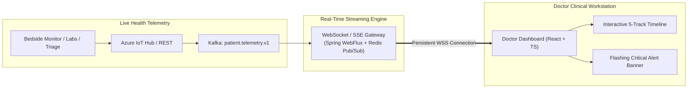
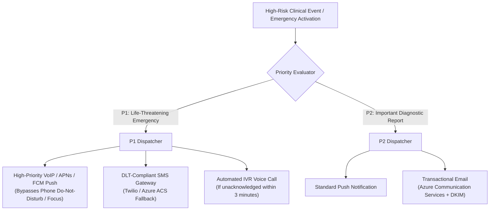
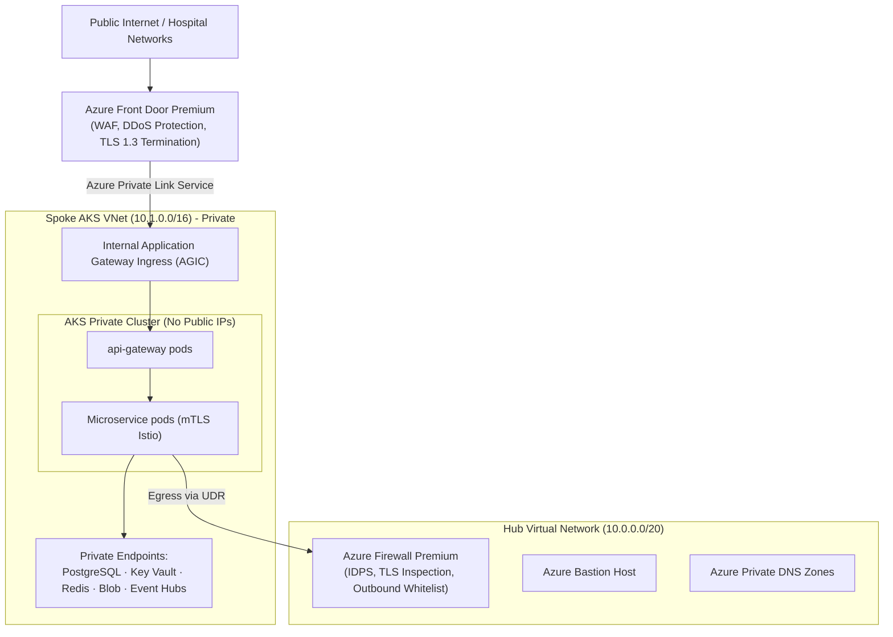
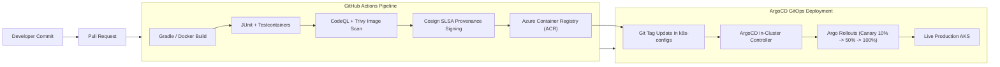

# MediVault AI — Module 5: Production Operations Platform

> Production Architecture Specification · v5.0 · Cloud Architect & Principal DevOps Engineer  
> Target: Resilient Offline Healthcare, Real-Time Hospital Clinical Operations, Observability, and Disaster Recovery  
> Infrastructure: Azure AKS · WatermelonDB + SQLCipher · Kafka · Redis · Prometheus · Grafana · ELK · GitHub Actions · ArgoCD

---

## 1. System Scope & Resilience Vision

Modern healthcare happens not only in well-connected urban teaching hospitals, but also in rural primary health centers, ambulances, emergency transport vehicles, and home health visits where cellular and broadband networks frequently drop.

The **Production Operations Platform** provides the enterprise backbone for MediVault AI:
1. **Offline Healthcare Mode:** Full clinical functionality without an active internet connection (encrypted local database, queueing, background synchronization).
2. **Clinical Conflict Resolution:** Vector clock and multi-version concurrency control (MVCC) designed specifically for medical invariants (e.g. allergies and active prescriptions are additive and never silently overwritten).
3. **Doctor Clinical Dashboard & Patient Timeline:** High-density, real-time clinical workstation with WebSocket event streaming.
4. **Mission-Critical Notification Engine:** Dual-channel SMS (DLT-compliant) and high-priority push/email with emergency quiet-hour bypass.
5. **Healthcare SRE & Observability:** Prometheus, Grafana, and ELK Stack with automated PHI redaction.
6. **Disaster Recovery & Zero-Trust Cloud Architecture:** Multi-region active-passive topology (Central India primary, South India DR) guaranteeing **RPO < 5 minutes and RTO < 1 hour**.

---

## 2. Offline Healthcare Architecture & Local Database

```mermaid
flowchart TD
  subgraph Client["Mobile / Tablet Device (React Native)"]
    UI["Doctor / Patient App UI"]
    WDB[("Local Encrypted Database<br/>(WatermelonDB + SQLCipher 256-bit AES)")]
    SYNC_ENGINE["Background Sync Engine<br/>(Delta Sync Worker)"]
    OUT_QUEUE[("Local Mutation Outbox<br/>(Pending Upload Queue)")]
    
    UI <-->|Local Query / Write (< 10ms)| WDB
    UI -->|Mutations| OUT_QUEUE
    OUT_QUEUE --> SYNC_ENGINE
  end

  subgraph Cloud["Azure Cloud (AKS)"]
    GW["api-gateway"]
    SYNC_SVC["sync-service<br/>(Delta Reconciliation)"]
    EVENT_HUB["Kafka Event Hub"]
    POSTGRES[("PostgreSQL 16 Primary DB")]
  end

  SYNC_ENGINE <==>|Bi-Directional Pull/Push<br/>(Network Reconnected)| GW
  GW <--> SYNC_SVC
  SYNC_SVC <--> POSTGRES
  SYNC_SVC --> EVENT_HUB
```

### 2.1 Local Storage Security (SQLCipher 256-bit)
On client devices (iOS, Android, and clinical Windows tablets):
- The database is encrypted at rest using **SQLCipher (AES-256-CBC)**.
- The 256-bit database key is derived using PBKDF2 (64,000 iterations) with salt and stored securely in the hardware **Secure Enclave / Android Keystore (StrongBox)**.
- **Biometric Binding:** Key access requires biometric authentication (FaceID / Fingerprint) or a 6-digit clinical offline PIN.

---

## 3. Synchronization Protocol & Clinical Conflict Resolution

### 3.1 Bi-Directional Delta Sync Algorithm
Instead of synchronizing full tables, MediVault uses a **Log-Structured Timestamp-Sequence Synchronization Protocol**:

1. **Pull (Server $\rightarrow$ Client):**
   - Client sends its last synchronized server sequence token: `GET /api/v1/sync?lastSequenceToken=1049283`.
   - Server returns all changes created/modified across patient records, appointments, and encounters since that token.
   - Client executes an atomic local batch transaction to update WatermelonDB.

2. **Push (Client $\rightarrow$ Server):**
   - Client flushes its local outbox of offline mutations with client timestamps and local UUIDv7 identifiers.
   - Server verifies authorization, applies transactional validation, checks for concurrency collisions, and updates `lastSequenceToken`.

### 3.2 Clinical Conflict Resolution Hierarchy

Traditional software sync uses "Last-Write-Wins" (LWW). In healthcare, **LWW is dangerous** (e.g., Doctor A adds an allergy to Penicillin offline at 10:00 AM; Doctor B updates the patient's phone number online at 10:05 AM $\rightarrow$ an LWW merge might overwrite or drop Doctor A's allergy record).

MediVault enforces **Domain-Specific 3-Way Clinical Merge Rules**:

| Data Domain | Merge Strategy | Conflict Handling Rule |
|---|---|---|
| **Allergies & Contraindications** | **Additive-Only Set (CRDT)** | Allergies can NEVER be overwritten by an offline sync. Both are retained; any deletion requires an explicit revocation record with physician signature. |
| **Active Medications** | **Multi-Version Reconciliation** | Concurrent modifications to the same medication generate a `PRESCRIPTION_DISCREPANCY` alert and place both into the Doctor Dashboard reconciliation queue. |
| **Vital Signs & Observations** | **Time-Series Append** | Every observation retains its recorded timestamp; conflicting timestamps for the same metric are preserved as dual readings (e.g. repeated blood pressure check). |
| **Demographics / Address** | **Field-Level LWW with Vector Clock** | Field-level resolution: if Doctor updates phone and Clerk updates address, both apply without conflict. |

---

## 4. Real-Time Clinical Dashboard & Patient Timeline



### 4.1 Interactive Patient Timeline Tracks
The clinical timeline renders 5 parallel chronological tracks over selectable zoom windows (24 Hours, 7 Days, 6 Months, 5 Years):
1. **Encounters & Admissions:** Emergency admissions, ICU stays, surgical procedures, discharge milestones.
2. **Medication Regimen Track:** Gantt-style medication administration bars (active, dose changes, discontinued).
3. **Diagnostic Lab Trends:** Interactive sparklines (Creatinine, Hemoglobin, Potassium, INR) with color-coded normal reference corridors.
4. **Diagnostic Imaging & Reports:** Thumbnail previews of radiographs, CT/MRI summaries, and ECG strips.
5. **Clinical Notes Track:** Physician notes, nursing assessments, and specialist consults with instant full-text search.

---

## 5. Mission-Critical Notification Infrastructure

Healthcare alerts demand multi-channel redundancy. MediVault utilizes a **Tri-Tier Notification Dispatcher**:



### DLT & Regulatory SMS Compliance (India & International)
- In compliance with TRAI (Telecom Regulatory Authority of India) and international telecom carriers, all medical SMS notifications utilize **DLT-Registered Principal Entity Templates**.
- High-priority clinical OTPs and emergency nominee alerts are assigned **Transactional / Service-Implicit Route (Header: MDVALT)** ensuring delivery within < 6 seconds 24/7/365.

---

## 6. SRE, Monitoring & Observability Architecture

### 6.1 Prometheus Metrics & Custom Healthcare KPIs

```text
# Healthcare Business & Technical Prometheus Metrics
medivault_emergency_snapshot_duration_seconds{quantile="0.99"}   # Must be < 0.300s
medivault_ocr_processing_duration_seconds{engine="paddleocr"}     # OCR speed tracking
medivault_ddi_alerts_total{severity="CRITICAL"}                   # Clinical safety counter
medivault_pdp_authorization_latency_seconds{status="PERMIT"}     # Access decision latency
medivault_offline_sync_queue_backlog_items                       # Sync worker health
```

### 6.2 ELK Logging Architecture with Automated PHI Redaction
Logs collected from microservices pass through a **Fluent Bit sidecar** containing automated regex masks to prevent any accidental PHI leakage:

```text
Input Log:
"User 0192.. requested record for patient Ramesh Patel (Aadhaar: 5491-2384-9102), Potassium: 6.2 mmol/L"

Fluent Bit Redaction Filter:
- Aadhaar / SSN Regex  -> [REDACTED_NATIONAL_ID]
- Phone Number Regex   -> [REDACTED_PHONE]
- Clinical Metric Value -> [REDACTED_CLINICAL_VALUE]

Indexed Elasticsearch Document:
"User 0192.. requested record for patient [REDACTED_NAME] (Aadhaar: [REDACTED_NATIONAL_ID]), Potassium: [REDACTED_CLINICAL_VALUE]"
```

---

## 7. Cloud Network Design & Zero-Trust Infrastructure



---

## 8. Disaster Recovery & Backup Strategy

| Component | Primary Region (Central India) | Secondary DR Region (South India) | Replication Method | RPO | RTO |
|---|---|---|---|---|---|
| **PostgreSQL Flexible Server** | Primary Active Instance (Zone-Redundant HA) | Read Replica (Warm Standby) | Physical streaming asynchronous replication | < 3 minutes | < 25 minutes (Failover Promoted) |
| **Blob Storage (Medical Vault)** | GZRS (Geo-Zone-Redundant) | Secondary read-access paired region | Automatic Azure GZRS cross-region geo-replication | < 5 minutes | Immediate (Read-Access Geo-Redundant) |
| **AKS Cluster** | 3 Availability Zones, 12 Nodes Autoscale | Standby AKS Cluster (Min 3 nodes) | GitOps (ArgoCD synchronizes manifests across both clusters) | 0 minutes | < 15 minutes (DNS reroute via Azure Front Door) |
| **Key Vault Premium** | Primary HSM Vault | Paired Geo-Replicated Vault | Azure native HSM key replication | 0 minutes | Immediate |

---

## 9. CI/CD Pipeline (GitHub Actions & ArgoCD GitOps)



---

## 10. Production Rollout Plan for Hospital Networks

```
PHASE 1: Core Cloud Infrastructure & AKS Foundation (Weeks 1–3)
├── Deploy Terraform Hub-and-Spoke VNets, Azure Firewall, Front Door Premium
├── Provision AKS Private Cluster, Key Vault HSM, and PostgreSQL Flexible Servers
└── Configure Prometheus, Grafana, and ELK Observability Stack

PHASE 2: Service Deployment & Offline Sync Certification (Weeks 4–6)
├── Deploy all microservices via ArgoCD GitOps
├── Stress-test offline WatermelonDB sync with 10,000 simulated intermittent drops
└── Verify automated zero-tolerance clinical conflict resolution rules

PHASE 3: Hospital EMR Integration & Pilot Sandbox (Weeks 7–9)
├── Establish HL7 / FHIR integration bridges with partner hospital hospital EMRs
├── Conduct simulated Emergency Department trials (mock trauma code scenarios)
└── Validate < 300ms emergency snapshot retrieval under 5,000 concurrent RPS

PHASE 4: Full Multi-Hospital Rollout & 24/7 SRE Handover (Weeks 10–12)
├── Regional failover disaster recovery drill (simulated primary region outage)
├── SOC2 Type II, ISO 27001, and HIPAA compliance audit verification
└── Production traffic cutover with 24/7 dedicated SRE rotational pager escalation
```
